# Organisation

## Le mur des questions

::: r-stack
[padlet.com/elichaput/PY00302T](https://padlet.com/elichaput/py00302t-mur-des-questions-5wr05uxj8nlbdqa0){style="font-size:20px;"}
:::

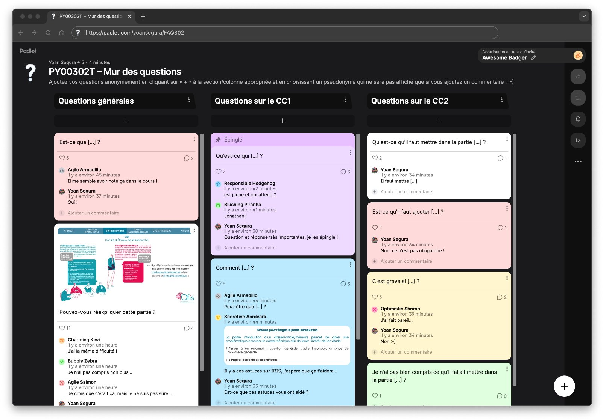{fig-align="center" width="75%" fig-alt="Un Padlet intitulé « mur des questions »"}

{.absolute top="45%" right="-10%" width="15%" fig-alt="Un QR code renvoyant vers le même Padlet que le lien."}

## Objectifs par séance

::: {.absolute left="10.5%" top="24%" style="color:#2E8A48; font-size:18px; font-weight:bold;"}
Pour la séance 2
:::

::: {.absolute left="-10%" top="28%" style="color:#2E8A48; font-size:18px;"}
Lire les articles à l'aide (ou non) de la fiche de
:::

::: {.absolute left="-7%" top="32%" style="color:#2E8A48; font-size:18px;"}
lecture et avancer sur le rapport de synthèses
:::

::: {.absolute left="19.5%" top="36%" style="color:#2E8A48; font-size:20px; font-weight:bold;"}
\|
:::

::: {.absolute left="48%" top="5%" style="color:#5B748F; font-size:18px; font-weight:bold;"}
Pour la séance 4
:::

::: {.absolute left="34%" top="9%" style="color:#5B748F; font-size:18px;"}
Avancer sur le [rapport de recherche]{.light-blue} ([partie]{.light-blue}
:::

::: {.absolute left="34%" top="13%" style="color:#5B748F; font-size:18px;"}
[méthode]{.light-blue}) et terminer le recueil des données
:::

::: {.absolute left="59.5%" top="17.7%" style="color:#5B748F; font-size:20px; font-weight:bold;"}
\|\
\|\
\|\
\|\
\|
:::

::: {.absolute right="-6%" top="20%" style="color:#5B748F; font-size:18px; font-weight:bold;"}
Pour la semaine suivante
:::

::: {.absolute right="-16%" top="24%" style="color:#5B748F; font-size:18px;"}
Terminer le [rapport de recherche]{.light-blue} ([parties]{.light-blue}
:::

::: {.absolute right="-14%" top="28%" style="color:#5B748F; font-size:18px;"}
[discussion-conclusion]{.light-blue}, [bibliographie]{.light-blue},
:::

::: {.absolute right="-13.3%" top="32%" style="color:#5B748F; font-size:18px;"}
[résumé]{.light-blue}, [table des matières]{.light-blue}, [annexes]{.light-blue})
:::

::: {.absolute left="99%" top="36%" style="color:#5B748F; font-size:20px; font-weight:bold;"}
\|
:::

{.absolute .r-stretch left="0%" top="40%" width="100%" fig-alt="Une barre de progression remplie à 10%, avant le travail requit pour la séance 2."}

::: {.absolute left="39.5%" top="62.5%" style="color:#5B748F; font-size:20px; font-weight:bold;"}
\|
:::

::: {.absolute left="24.8%" top="66.5%" style="color:#5B748F; font-size:18px; font-weight:bold;"}
Pour la séance 3
:::

::: {.absolute left="8%" top="70.5%" style="color:#5B748F; font-size:18px;"}
Terminer le [rapport de synthèses]{.light-blue} et avancer sur
:::

::: {.absolute left="11.2%" top="74.5%" style="color:#5B748F; font-size:18px;"}
le [rapport de recherche]{.light-blue} ([mise en forme du]{.light-blue}
:::

::: {.absolute left="9.1%" top="78.5%" style="color:#5B748F; font-size:18px;"}
[document]{.light-blue}, [page de garde]{.light-blue}, [partie introduction]{.light-blue})
:::

::: {.absolute left="9.1%" top="82.5%" style="color:#5B748F; font-size:18px;"}
et l'expérience (apporter le matériel en plus
:::

::: {.absolute left="11.8%" top="87.5%" style="color:#5B748F; font-size:18px;"}
nécessaire pour construire l'expérience)
:::

::: {.absolute left="79.3%" top="62.5%" style="color:#5B748F; font-size:20px; font-weight:bold;"}
\|
:::

::: {.absolute left="78%" top="66.5%" style="color:#5B748F; font-size:18px; font-weight:bold;"}
Pour la séance 5
:::

::: {.absolute right="-5%" top="70.5%" style="color:#5B748F; font-size:18px;"}
Avancer sur le [rapport de recherche]{.light-blue}
:::

::: {.absolute left="77%" top="74.5%" style="color:#5B748F; font-size:18px;"}
(partie [résultats]{.light-blue})
:::

# Intelligence Artificielle

## Rôle de l'Intelligence Artificielle (IA) dans les apprentissages {.smaller style="text-align: center"}

### Ouvrons le débat !

:::::: columns
::: {#vcenter .column width="32%"}
[Utilisez-vous fréquemment des IA comme]{style="font-weight: bold"}[ChatGPT]{.highlighted-light} ?
:::

::: {.column width="36%"}
{fig-align="center" width="100%" fig-alt="Un meme sur l'utilisation de ChatGPT pour faire son travail."}  
[What do you think?]{style="font-weight: lighter"}
:::

::: {#vcenter .column width="32%"}
[Percevez-vous parfois des]{style="font-weight: bold"}[limites]{.highlighted-light} et/ou des [désavantages]{.highlighted-light} à cette utilisation ?
:::
::::::

::: notes
– Il nous paraissait intéressant d’introduire dans cette UE un débat sur l’IA au regard de son utilisation quotidienne

– Je ne suis pas spécialiste, l’idée est d’échanger avec vous en toute transparence sans aucun jugement ni tabou

– Avant de montrer les questions, ouvrir la discussion sur le fait qu’il n’y a pas de jugements ou mauvaises réponses : il s’agit pour nous de mieux comprendre leur utilisation pour mieux les guider !

– «Utilisez-vous fréquemment des IA comme ChatGPT ?» : l’idée est de savoir si l’utilisation est quotidienne et pour quels usages (uniquement les cours ou pas)

– «Percevez-vous parfois des limites ou désavantages à cette utilisation ?» : l’idée est de savoir si elles/s’ils perçoivent 1) que ça peut limiter leurs apprentissages selon la façon dont elles/ils l’utilisent ; et 2) que ces outils ne sont pas fiables

– Meme : plusieurs niveaux de lecture, le but est de les amener à penser chaque niveau (spontanément, dans l’idéal)\
1) Qu’en pensez-vous en termes de futur ? Est-ce une crainte ?\
2) Qu’en pensez-vous en termes d’apprentissage au jour le jour ?\
3) Et du point de vue des enseignantes/enseignants : pensez-vous qu’elles/ils se posent ces questions ? Et qu’elles/ils y répondent/réagissent efficacement ?
:::

## Rôle de l'Intelligence Artificielle (IA) dans les apprentissages {.smaller style="text-align: center; font-size: 20px"}

### Ouvrons le débat !

Avec l'IA, [la question n’est pas simplement "comment évaluer les étudiantes/étudiants ?" ou "comment empêcher son utilisation ?"]{style="font-weight: bold"}

- [Qu’est-ce que ChatGPT ?]{style="font-weight: bold"}\
  Un [modèle de langage]{.blue} : il prédit le mot suivant en se basant sur d'énormes bases de textes\
  Il n’a pas de compréhension du monde, il fait fréquemment des [erreurs]{.blue} et est sujet à des [hallucinations]{.blue}\
  [↳ Enjeu n°1: ne pas le prendre pour plus intelligent qu’il ne l’est réellement]{.highlighted-light}

- [Chaque requête consomme de l'énergie]{style="font-weight: bold"}\
  GPT-3 : jusqu’à 0,1 kWh par requête ≈ [une charge de smartphone]{.blue}\
  Refroidissement des serveurs : [centaines de milliers de litres d’eau]{.blue}\
  [↳ Enjeu n°2 : ce n’est pas gratuit pour la planète]{.highlighted-light}

::: aside
[Pour aller plus loin : conférence sur l’IA par Jean-Gabriel Ganascia en]{style="font-size:15px"} [cliquant ici](www.univ-tlse2.fr/accueil/recherche/en-quoi-lia-transforme-les-pratiques-dans-lenseignement-superieur-et-la-recherche){style="font-size:15px"}
:::

::: notes
– Pour rebondir sur le dernier point (enseignantes/enseignants), l’IA n’est pas un outil à empêcher/contrôler à tout prix, mais à prendre en compte désormais

– En revanche, il faut prendre certaines précautions et bien comprendre les enjeux

– S’assurer qu’elles/ils connaissent la différence entre erreurs et hallucinations

– Source en lien cliquable sur la diapositive : https://www.univ-tlse2.fr/accueil/recherche/en-quoi-lia-transforme-les-pratiques-dans-lenseignement-superieur-et-la-recherche (la conférence est appliquée aux pratiques de l’enseignement, mais a toute une première partie sur la définition de l’IA en lien avec l’intelligence de façon plus « générale »)
:::

## Rôle de l'Intelligence Artificielle (IA) dans les apprentissages {.smaller style="text-align: center; font-size: 20px"}

### Ouvrons le débat !

Avec l'IA, [la question n’est pas simplement "comment évaluer les étudiantes/étudiants ?" ou "comment empêcher son utilisation ?"]{style="font-weight: bold"}

- [Du point de vue de l'éthique]{style="font-weight: bold"}\
  [Plagiat passif]{.blue} : vous êtes responsables de ce que vous "empruntez" à ChatGP\
  Paramètres de [confidentialité]{.blue} à questionner\
  Risques de [contenus discriminants]{.blue} ou [biaisés]{.blue} selon ce qui "nourrit" majoritairement l’IA\
  [↳ Enjeu n°3 : être au clair sur les questions éthiques]{.highlighted-light}

::: aside
[Pour aller plus loin : conférence sur l’IA par Jean-Gabriel Ganascia en]{style="font-size:15px"} [cliquant ici](www.univ-tlse2.fr/accueil/recherche/en-quoi-lia-transforme-les-pratiques-dans-lenseignement-superieur-et-la-recherche){style="font-size:15px"}
:::

::: notes
– Source en lien cliquable sur la diapositive : https://www.univ-tlse2.fr/accueil/recherche/en-quoi-lia-transforme-les-pratiques-dans-lenseignement-superieur-et-la-recherche (la conférence est appliquée aux pratiques de l’enseignement, mais a toute une première partie sur la définition de l’IA en lien avec l’intelligence de façon plus « générale »)

– Bonus : Jean-Gabriel Ganascia, spécialiste de l’I.A., a rédigé un livre vulgarisé pour les plus intéressé-es : « L’I.A. expliquée aux humains »
:::

## Rôle de l'Intelligence Artificielle (IA) dans les apprentissages {.smaller style="text-align: center; font-size: 20px"}

### Ouvrons le débat !

Pour autant, les [IA sont des outils très utiles si elles sont bien utilisées]{style="font-weight: bold"}\
Il est donc important de [savoir optimiser leur utilisation]{style="font-weight: bold"}

- [Pourquoi utiliser ChatGPT ? (non exhaustif)]{style="font-weight: bold"}\
  [✓]{style="color:green;"} Générer des QCM ou des quiz pour s’auto-évaluer et s’entraîner\
  [✓]{style="color:green;"} Reformuler des concepts\
  [✗]{style="color:red;"} Ne jamais confier une tâche d’analyse ou d’interprétation statistique sans [relecture critique]{.blue}

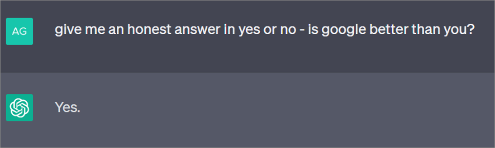{fig-align="center" width="40%" fig-alt="Prompt sur ChatGPT: give me an honest answer in yes or no - is google better than you? / Réponse de ChatGPT: Yes."}

::: notes
– Bien faire la différence entre « un outil pour faire mieux » et « un outil pour faire à ma place »

– Rappeler les risques liés au fait de tout lui confier sans regard critique et sans vérifier TOUTES les informations

– Au final, c’est exactement le même rapport qu’avec une/un collègue de promo. : une personne peut nous aider à nous évaluer, à ré-expliquer des concepts, mais personne ne ferait une confiance aveugle au point de la/le laisser faire tout à notre place sans vérifier ce qui a été fait

– Au mieux, un terrible syndrome de l’imposteur ; au pire, une mauvaise note pour cause de passivité trop importante

– Utiliser correctement ChatGPT peut paraître « barbant » et « vieux-jeu » face à la rapidité à laquelle il est possible de l’utiliser sans ces conseils, néanmoins, l’utiliser de manière optimale vous permet d’être mieux renseigné-e
:::

## Rôle de l'Intelligence Artificielle (IA) dans les apprentissages {.smaller style="text-align: center; font-size: 20px"}

### Ouvrons le débat !

Pour autant, les [IA sont des outils très utiles si elles sont bien utilisées]{style="font-weight: bold"}\
Il est donc important de [savoir optimiser leur utilisation]{style="font-weight: bold"}

- [Comment utiliser ChatGPT ? (non exhaustif)]{style="font-weight: bold"}

  [1. Apprendre à poser les "bonnes" questions:]{style="font-weight: bold"} "[prompts]{.highlighted-light}"\
  [↳ Faire preuve de précision]{.highlighted-light} dans les termes et les attentes\
  Exemple :\
  [✗]{style="color:red;"} "Qu’est-ce que la mémoire de travail ?"\
  [✓]{style="color:green;"} "Explique-moi le modèle de la mémoire de travail de Baddeley pour un niveau de licence de psychologie ; donne un exemple expérimental ainsi que les références sur lesquelles tu t’es appuyé."

::: notes
– Bien travailler avec ChatGPT, c’est avoir un dialogue avec lui plutôt qu’un simple long monologue de sa part : l’aider à affiner, lui demander de re-préciser, poser la même question autrement, etc.

– Toujours vérifier ce qu’il dit : il n’est pas possible de lui faire confiance les yeux fermés et d’espérer des résultats fiables
:::

## Rôle de l'Intelligence Artificielle (IA) dans les apprentissages {.smaller style="text-align: center; font-size: 20px"}

### Ouvrons le débat !

Pour autant, les [IA sont des outils très utiles si elles sont bien utilisées]{style="font-weight: bold"}\
Il est donc important de [savoir optimiser leur utilisation]{style="font-weight: bold"}

- [Comment utiliser ChatGPT ? (non exhaustif)]{style="font-weight: bold"}

  [1. Apprendre à poser les "bonnes" questions:]{style="font-weight: bold"} "[prompts]{.highlighted-light}"

  [2. Poser plusieurs questions et]{style="font-weight: bold"} [comparer]{.highlighted-light} les réponses, notamment avec les cours/formations/autre\
  ↳ Ne jamais se contenter d’une réponse de ChatGPT, mais [recouper les informations]{.highlighted-light}

::: notes
– ChatGPT a BEAUCOUP d’hallucinations, même en résumant un PDF que nous lui donnons
:::

## Rôle de l'Intelligence Artificielle (IA) dans les apprentissages {.smaller style="text-align: center; font-size: 20px"}

### Ouvrons le débat !

Pour autant, les [IA sont des outils très utiles si elles sont bien utilisées]{style="font-weight: bold"}\
Il est donc important de [savoir optimiser leur utilisation]{style="font-weight: bold"}

- [Comment utiliser ChatGPT ? (non exhaustif)]{style="font-weight: bold"}

  [1. Apprendre à poser les "bonnes" questions: "]{style="font-weight: bold"}[prompts]{.highlighted-light}"

  [2. Poser plusieurs questions et]{style="font-weight: bold"} [comparer]{.highlighted-light} les réponses, notamment avec les cours/formations/autre

  [3. Demander et]{style="font-weight: bold"} [vérifier]{.highlighted-light} les sources sur lesquelles il s’appuie\
  ↳ Lui demander de fournir les références et [vérifier qu’elles existent]{.highlighted-light}

::: notes
– ChatGPT invente beaucoup de fausses références pour donner un genre académique… sauf que ces références n’existent pas
:::

## Rôle de l'Intelligence Artificielle (IA) dans les apprentissages {.smaller style="text-align: center; font-size: 20px"}

### Ouvrons le débat !

Pour autant, les [IA sont des outils très utiles si elles sont bien utilisées]{style="font-weight: bold"}\
Il est donc important de [savoir optimiser leur utilisation]{style="font-weight: bold"}

- [3 catégories d’utilisation inappropriée de l’IA dans toute production]{style="font-weight: bold"}

  [1. Générer]{style="font-weight: bold"} un produit et le présenter comme son propre travail ou sa propre idée [sans attribuer à l’IA sa "parentalité"]{.highlighted-light}

  [2. Générer]{style="font-weight: bold"} une sortie, la paraphraser, puis présenter la sortie comme son propre travail ou sa propre idée [sans attribuer à l’IA sa "parentalité"]{.highlighted-light}

  [3. Traiter]{style="font-weight: bold"} une source originale non créée par soi-même pour la plagier [sans attribuer à l’IA sa "parentalité"]{.highlighted-light}\
  Exemple :\
  Utiliser un outil de paraphrase d’IA pour déguiser le travail original d’une autre personne ou le résultat d’un autre outil d’IA, puis présenter le résultat final comme son propre travail ou sa propre idée

::: notes
– Dans le cadre de cette UE, l’IA ne doit pas être utilisée pour produire une synthèse ou un rapport de recherche, mais peut être utilisée pour reformuler des paragraphes en attribuant la « parentalité » de la production à l’IA ou auto-évaluer sa propre production, de même qu’elle peut être utilisée pour développer sa créativité
:::

## Rôle de l'Intelligence Artificielle (IA) dans les apprentissages {.smaller style="text-align: center; font-size: 20px"}

### Vers une charte

ChatGPT est un **outil utile s’il est bien utilisé** qui peut **vous aider à apprendre**, mais **pas apprendre à votre place**\
Une **bonne utilisation a un coût** (en termes de temps et d’efforts) **parfois plus important que les gains**

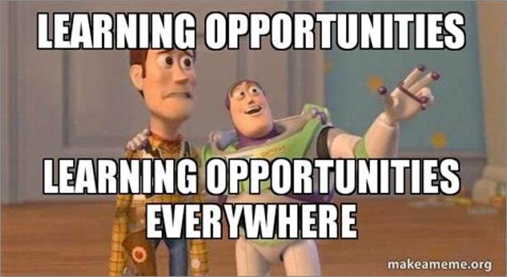{fig-align="center" width="40%" fig-alt="Un meme représentant Woody et Buzz L'éclair de Toy Story, avec la légende : LEARNING OPPORTUNITIES / LEARNING OPPORTUNITIES EVERYWHERE."}

- **Charte d’usage responsable (non exhaustive) :**\
  Je me sers de ChatGPT pour réfléchir et non déléguer\
  Je reste actrice/acteur de mon apprentissage\
  Je vérifie toute information dans des sources (scientifiques) fiables\
  Je ne rends jamais un texte généré sans l’avoir compris, adapté et critiqué

::: notes
– En bref, ne pas se précipiter sur ChatGPT car la stratégie à privilégier est parfois ailleurs

– Idem pour le reste de la vie quotidienne (p. ex. e-mails), il faut garder confiance en ses capacités de raisonnement

– Il est parfois légitime d’avoir recours à l’IA pour : rassembler des informations et rechercher des explications sur des concepts de base ; ou générer des productions pour aiguiser son analyse critique, pour l’auto-apprentissage ou pour comparer sa propre production avec une autre pour s’auto-évaluer et ainsi améliorer ses propres compétences d’analyse et rédactionnelles
:::

## Rôle de l'Intelligence Artificielle (IA) dans les apprentissages {.smaller style="text-align: center; font-size: 20px"}

### Vers une charte

ChatGPT est un **outil utile s’il est bien utilisé** qui peut **vous aider à apprendre**, mais **pas apprendre à votre place**\
Une **bonne utilisation a un coût** (en termes de temps et d’efforts) **parfois plus important que les gains**

- **Penser à reconnaître son utilisation s’il y en a une dans le cadre d’une production** (écrite, orale, autre)\
  ↳ Faire une "[Déclaration usage d’un outil d’IA]{.blue}" après la page de garde dans les travaux\
  ↳ Penser à citer l’IA générative dans le texte et dans la bibliographie\
  Exemple :\
  "Le texte généré par ChatGPT \[…\] (OpenAI, 2023)."

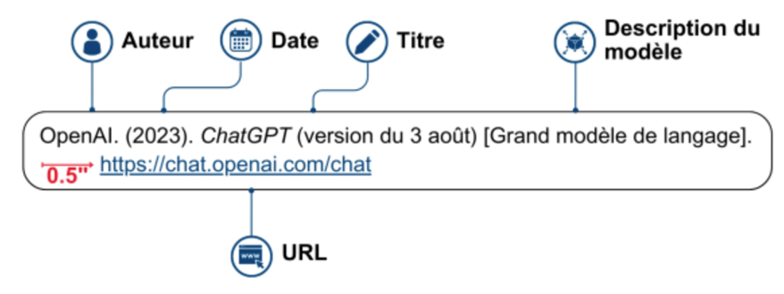{.absolute bottom="8%" right="5%" width="35%" fig-alt="Un meme représentant Woody et Buzz L'éclair de Toy Story, avec la légende : LEARNING OPPORTUNITIES / LEARNING OPPORTUNITIES EVERYWHERE."}

::: aside
[https://www.umoncton.ca/integrite/comment_citer_chatgpt](https://www.umoncton.ca/integrite/comment_citer_chatgpt){style="font-size:15px"}
:::

::: notes
– Pensez à citer l’IA, sinon c’est une fraude et un plagiat

– C’est peut-être peu intuitif au début, mais le maître mot est la transparence !
:::

## Rôle de l'Intelligence Artificielle (IA) dans les apprentissages {.smaller style="text-align: center; font-size: 20px"}

::: r-stack


{height="480" width="270" fig-alt="Un smartphone vu de face."}
:::

::: aside
[https://www.youtube.com/shorts/5lRu8IJZJ1U](https://www.youtube.com/shorts/5lRu8IJZJ1U){style="font-size:15px"}
:::

::: notes
– Diapositive bonus (s’il y a du temps) : il s’agit d’une vidéo d’une vulgarisatrice scientifique qui sensibilise à la recherche d’information via l’IA, elle dure environ 1 minute
:::

# Démarche expérimentale

## Schématisation

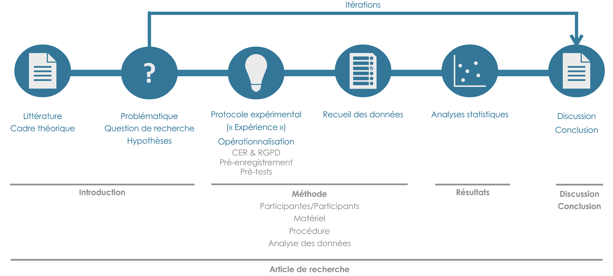{.absolute .r-stretch left="0%" top="15%" width="100%" fig-alt="Schéma représentant la chronologie de la démarche expérimentale."}

::: aside
Figure par Yoan Segura
:::

::: notes
– Une des diapositives les plus importantes à garder en tête dans le cadre de cette UE ! Elle vous donne le plan pour la construction de votre rapport de recherche
:::

## Corrélation & Causalité {style="text-align: center;"}

::: r-stack


{height="550" width="280" fig-alt="Un smartphone vu de face."}
:::

::: aside
[https://www.instagram.com/reel/DLaNaScIgeu/](https://www.instagram.com/reel/DLaNaScIgeu/){style="font-size:15px"}
:::

## Corrélation & Causalité {style="text-align: center;"}
### On peut corréler de nombreuses données...

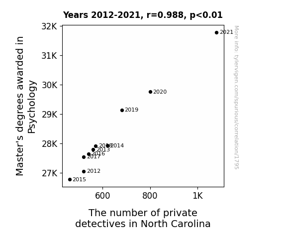{.absolute top="20%" left="10%" width="40%" fig-alt="Corrélation entre le nombre de diplômes délivrés en Psychologie et le nombre de détectives privés en Caroline du Nord"}

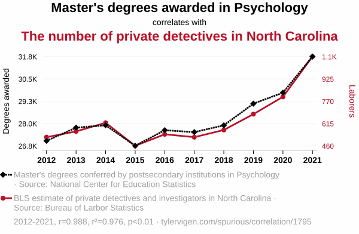{.absolute top="40%" right="10%" width="40%" fig-alt="Evolution du nombre de diplômes délivrés en Psychologie et du nombre de détectives privés en Caroline du Nord"}

::: aside
[https://www.tylervigen.com/spurious/discover](https://www.tylervigen.com/spurious/discover){style="font-size:15px"}
:::

## Corrélation & Causalité {style="text-align: center;"}
### ...qui n'ont en réalité aucun rapport !

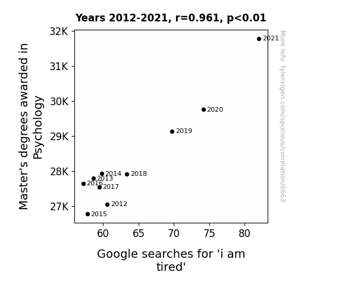{.absolute top="20%" left="10%" width="40%" fig-alt="Corrélation entre le nombre de diplômes délivrés en Psychologie et le nombre de recherches Google pour: Je suis fatigué"}

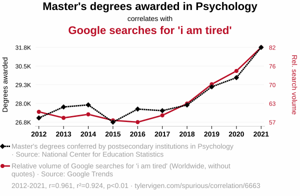{.absolute top="40%" right="10%" width="40%" fig-alt="Evolution du nombre de diplômes délivrés en Psychologie et du nombre de recherches Google pour: Je suis fatigué"}

::: aside
[https://www.tylervigen.com/spurious/discover](https://www.tylervigen.com/spurious/discover){style="font-size:15px"}
:::

## Corrélation & Causalité {style="text-align: center;"}
### Attention à la distinction !

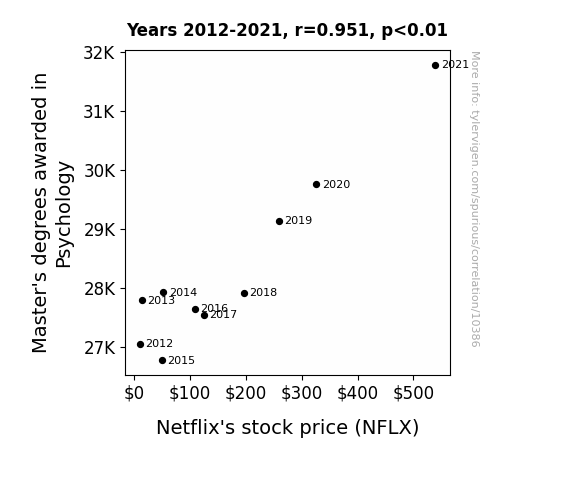{.absolute top="20%" left="10%" width="40%" fig-alt="Corrélation entre le nombre de diplômes délivrés en Psychologie et le cours des actions en Bourse de Netflix"}

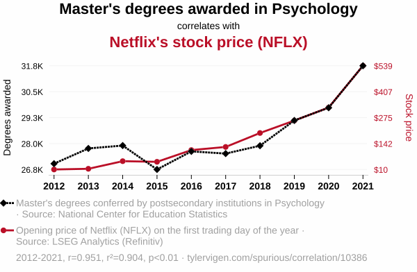{.absolute top="40%" right="10%" width="40%" fig-alt="Evolution du nombre de diplômes délivrés en Psychologie et du cours des actions en Bourse de Netflix"}

::: aside
[https://www.tylervigen.com/spurious/discover](https://www.tylervigen.com/spurious/discover){style="font-size:15px"}
:::

# Normes APA

## Exemples d'outils {.smaller style="text-align: center;"}

Normes APA version 7 - [http://www.apa.org/](http://www.apa.org/)

:::::: columns
::: {.column width="50%"}
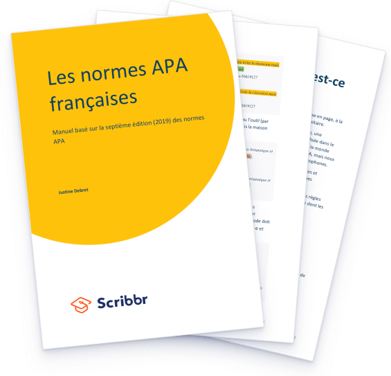{.fragment data-fragment-index="1" fig-align="center" width="100%" fig-alt="Le guide des normes APA françaises édité par Scribbr"}
:::

::: {#vcenter .column width="50%"}
{.fragment data-fragment-index="2" fig-align="center" width="20%" fig-alt="Le logo de Zotero, un gestionnaire bibliographique."}

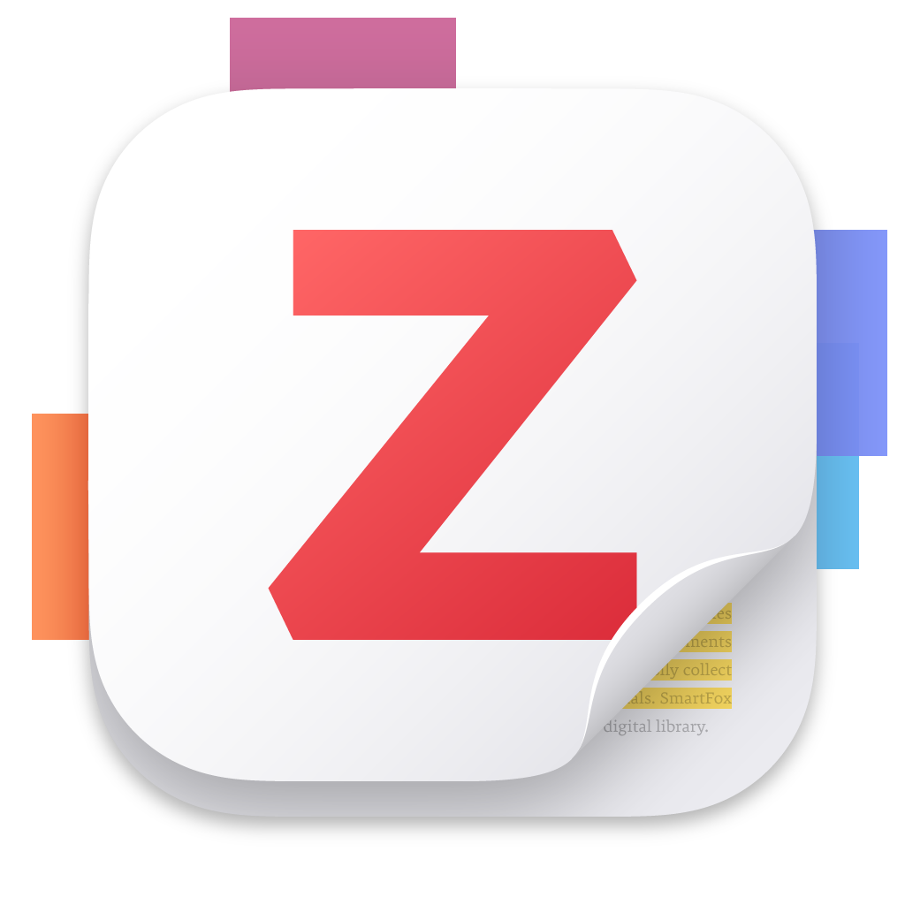{.fragment data-fragment-index="2" fig-align="center" width="40%" fig-alt="L'icône de Zotero, un gestionnaire bibliographique."}

[Logiciel ou version en ligne]{.fragment data-fragment-index="2"}
:::
::::::

::: aside
[https://www.scribbr.fr/manuel-normes-apa/](https://www.scribbr.fr/manuel-normes-apa/){style="font-size:15px"} [&]{style="font-size:15px"} [https://www.zotero.org/](https://www.zotero.org/){style="font-size:15px"}
:::

::: notes
– APA : American Psychological Association – association de chercheuses/chercheurs et praticiennes/praticiens en psychologie et en psychiatrie ; il s’agit d’une association affiliée à de nombreuses revues telles que l’ensemble des JEP (Journal of Experimental Psychology, en psychologie cognitive, etc.)

– Elle régit les normes de rédaction d’un document en vue d’une publication et sont utilisées dans toutes les revues ayant trait à la psychologie
:::

## Exemples d'outils {.smaller style="text-align: center;"}

Normes APA version 7 - [http://www.apa.org/](http://www.apa.org/)

:::::: columns
::: {.column width="50%"}
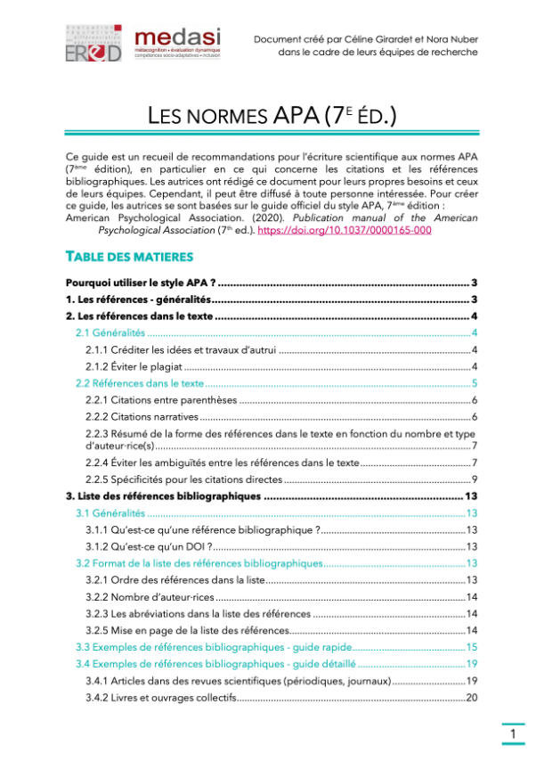{fig-align="center" width="70%" fig-alt="Le guide des normes APA françaises de Girdardet & Nuber."}
:::

::: {#vcenter .column width="50%"}
{fig-align="center" width="20%" fig-alt="Le logo de Zotero, un gestionnaire bibliographique."}

{fig-align="center" width="40%" fig-alt="L'icône de Zotero, un gestionnaire bibliographique."}

Logiciel ou version en ligne
:::
::::::

::: aside
[https://www.hepl.ch/files/live/sites/files-site/files/filiere-ps/programme-formation/normes-apa-stage-maeps-fps-hep-vaud.pdf](https://www.hepl.ch/files/live/sites/files-site/files/filiere-ps/programme-formation/normes-apa-stage-maeps-fps-hep-vaud.pdf){style="font-size:15px"} [&]{style="font-size:15px"} [https://www.zotero.org/](https://www.zotero.org/){style="font-size:15px"}
:::

::: notes
– Si le guide des normes APA de scribbr ne vous convient pas, il y a également le guide de Girardet & Nuber avec leurs équipes de recherche qui est peut-être plus synthétique et complémentaire
:::

## Manuel français des normes APA {.smaller style="text-align: center;"}

:::::: columns
::: {.column width="33%"}
[**Citer dans le texte**]{.blue}

[**Forme narrative**]{.fragment data-fragment-index="1"}  
[2 personnes : Pistono et Segura (2025)]{.fragment data-fragment-index="1"}  
[+2 personnes : Pistono et al. (2025)]{.fragment data-fragment-index="1"}  

[**Forme entre parenthèses**]{.fragment data-fragment-index="1"}  
[2 personnes : (Pistono & Segura, 2025)]{.fragment data-fragment-index="1"}  
[+2 personnes : (Pistono et al., 2025)]{.fragment data-fragment-index="1"}  
[+2 références : (Pistono, 2025; Pistono, 2026)]{.fragment data-fragment-index="1"}  

[**Cas particulier n°1**]{.fragment data-fragment-index="1"}  
[Même auteur, même année : Pistono (2025), Pistono (2025)]{.fragment data-fragment-index="1"}
:::

::: {.column width="34%"}
[**Citer dans la bibliographie**]{.blue}
:::

::: {.column width="33%"}
[**Mise en forme**]{.blue}
:::
::::::

::: notes
– Citer dans le texte : les 2 questions à se poser sont 1) est-ce que vous souhaitez une forme narrative ou une forme entre parenthèses ? ; et 2) combien y a-t-il d’autrices/personnes ? 

– Cas particulier n°1 : il peut y avoir 2 articles avec les mêmes personnes, la même année, ce qui donne par exemple Pistono (2025) et Pistono (2025) [diapositive suivante pour la suite]

– Si vous tombez sur des cas particuliers, nous pourrons le voir au cas par cas
:::

## Manuel français des normes APA {.smaller style="text-align: center;"}

:::::: columns
::: {.column width="33%"}
[**Citer dans le texte**]{.blue}

**Forme narrative**  
2 personnes : Pistono et Segura (2025)  
+2 personnes : Pistono et al. (2025)  

**Forme entre parenthèses**  
2 personnes : (Pistono & Segura, 2025)  
+2 personnes : (Pistono et al., 2025)  
+2 références : (Pistono, 2025; Pistono, 2026)  

**Cas particulier n°1**  
Pistono (2025a), Pistono (2025b)
:::

::: {.column width="34%"}
[**Citer dans la bibliographie**]{.blue}
:::

::: {.column width="33%"}
[**Mise en forme**]{.blue}
:::
::::::

::: notes
– Pour se repérer, il faut ajouter une lettre à côté des années de telle sorte que cela fasse Pistono (2025a) et Pistono (2025b)

– Cette lettre devra également apparaître dans la bibliographie

– Si vous tombez sur des cas particuliers, nous pourrons le voir au cas par cas
:::

## Manuel français des normes APA {.smaller style="text-align: center;"}

:::::: columns
::: {.column width="33%"}
[**Citer dans le texte**]{.blue}

**Forme narrative**  
2 personnes : Pistono et Segura (2025)  
+2 personnes : Pistono et al. (2025)  

**Forme entre parenthèses**  
2 personnes : (Pistono & Segura, 2025)  
+2 personnes : (Pistono et al., 2025)  
+2 références : (Pistono, 2025; Pistono, 2026)  

**Cas particulier n°2**  
Equipes différentes : Pistono et al. (2025), Pistono et al. (2025)
:::

::: {.column width="34%"}
[**Citer dans la bibliographie**]{.blue}
:::

::: {.column width="33%"}
[**Mise en forme**]{.blue}
:::
::::::

::: notes
– Cas particulier n°2 : il peut y avoir 2 articles avec la même première autrice/le même premier auteur, mais une suite d’autrices/personnes différente, la même année, ce qui donne par exemple Pistono et al. (2025) et Pistono et al. (2025) [diapositive suivante pour la suite]

– Si vous tombez sur des cas particuliers, nous pourrons le voir au cas par cas
:::

## Manuel français des normes APA {.smaller style="text-align: center;"}

:::::: columns
::: {.column width="33%"}
[**Citer dans le texte**]{.blue}

**Forme narrative**  
2 personnes : Pistono et Segura (2025)  
+2 personnes : Pistono et al. (2025)  

**Forme entre parenthèses**  
2 personnes : (Pistono & Segura, 2025)  
+2 personnes : (Pistono et al., 2025)  
+2 références : (Pistono, 2025; Pistono, 2026)  

**Cas particulier n°2**  
Pistono, Bringuier et al. (2025), Pistono, Segura et al. (2025)
:::

::: {.column width="34%"}
[**Citer dans la bibliographie**]{.blue}
:::

::: {.column width="33%"}
[**Mise en forme**]{.blue}
:::
::::::

::: notes
– Pour se repérer, il faut ajouter une autrice/un auteur devant « et al. »

– Si vous tombez sur des cas particuliers, nous pourrons le voir au cas par cas
:::

## Manuel français des normes APA {.smaller style="text-align: center;"}

:::::: columns
::: {.column width="33%"}
[**Citer dans le texte**]{.blue}
:::

::: {.column width="34%"}
[**Citer dans la bibliographie**]{.blue}

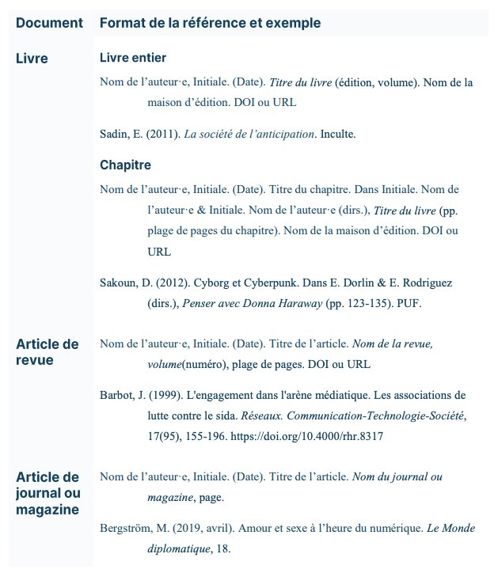{fig-align="center" width="100%" fig-alt="Des exemples de citation en bibliographie aux normes APA, 7e édition."}

[https://www.scribbr.fr/manuel-normes-apa/](https://www.scribbr.fr/manuel-normes-apa/)
:::

::: {.column width="33%"}
[**Mise en forme**]{.blue}
:::
::::::

::: notes
– Citer dans la bibliographie : vous avez un tableau pages 5 à 8 avec les différentes façons de citer selon la nature du document (il n’y a que 3 exemples sur cette diapositive)

– Article de revue = tous les articles que je vous ai donnés quasiment

– Lien à mettre au tableau : https://psycnet.apa.org/ — les références de ce site sont les plus fiables (mais elles n’y sont pas toutes)

– Bonus : seulement les 19 premières autrices/premiers personnes et le 20ème sont à citer dans la bibliographie s’il y en a plus de 20, il faut mettre « … » entre les 19 premières/premiers et le dernier

– Parfois il n’y aurait pas toutes les informations parfaites comme dans les exemples, si c’est le cas l’important c’est de mettre toutes les informations que vous avez (sans en inventer évidemment)
:::

## Manuel français des normes APA {.smaller style="text-align: center;"}

:::::: columns
::: {.column width="33%"}
[**Citer dans le texte**]{.blue}
:::

::: {.column width="34%"}
[**Citer dans la bibliographie**]{.blue}
:::

::: {.column width="33%"}
[**Mise en forme**]{.blue}  
[Corps du texte]{.blue}

**Toutes les marges** : 2,54 cm  
**Police** : Times New Roman taille 12  
**Alignement** : gauche (justifié accepté)  
**Début de paragraphe** : indentation 1,27 cm  
**Interligne** : 1,5  
**En-tête** : titre et pagination

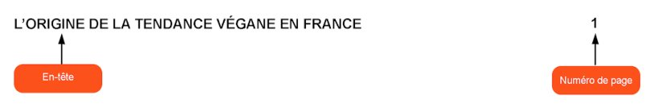{fig-align="center" width="100%" fig-alt="Un exemple de mise en forme de l'en-tête aux normes APA, 7e édition."}
:::
::::::

::: notes
– Le manuel propose plusieurs polices, mais la plus reconnue reste Times New Roman en taille 12

– Normalement, l’alignement est à gauche selon les normes APA version 7 (des recherches montrent que cela facilite la lecture), mais j’accepte que vos travaux soient en justifié

– L’en-tête doit comporter le titre à gauche et la pagination à droite (la pagination peut paraître contre-intuitive, mais elle est bien en haut à droite des pages donc)

– Pour les détails des mises en forme des tableaux, des figures, de la bibliographie, etc., je vous laisse vous servir du guide, je n’irai pas plus dans le détail, mais vous pourrez me demander si besoin

– Ne prenez pas la mise en forme et les normes APA par extension à la légère, je serai tatillon là-dessus car c’est important pour la suite (TER, mémoires)
:::

## Manuel français des normes APA {.smaller style="text-align: center;"}

:::::: columns
::: {.column width="33%"}
[**Citer dans le texte**]{.blue}
:::

::: {.column width="34%"}
[**Citer dans la bibliographie**]{.blue}
:::

::: {.column width="33%"}
[**Mise en forme**]{.blue}  
[Titres et sous-titres]{.blue}

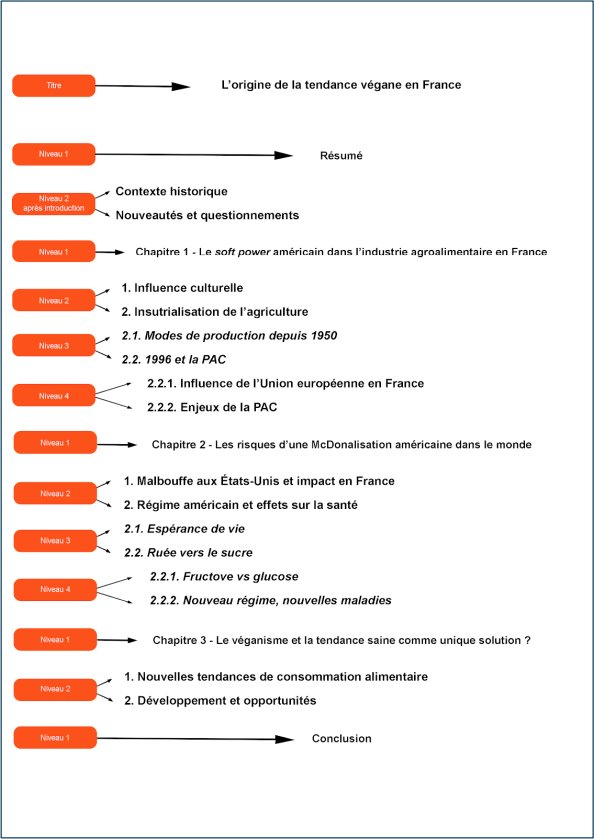{fig-align="center" width="100%" fig-alt="Des exemples de mise en forme aux normes APA 7e édition."}
:::
::::::

::: notes
– Dans le manuel, vous avez des exemples pour illustrer les mises en forme
:::

## Manuel français des normes APA {.smaller style="text-align: center;"}

:::::: columns
::: {.column width="33%"}
[**Citer dans le texte**]{.blue}
:::

::: {.column width="34%"}
[**Citer dans la bibliographie**]{.blue}
:::

::: {.column width="33%"}
[**Mise en forme**]{.blue}  
[Bibliographie]{.blue}

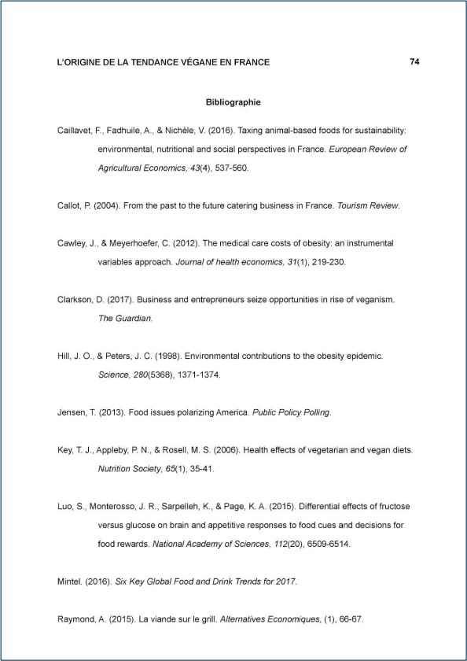{fig-align="center" width="100%" fig-alt="Des exemples de mise en forme de la bibliographie aux normes APA 7e édition."}
:::
::::::

## Manuel français des normes APA {.smaller style="text-align: center;"}

:::::: columns
::: {.column width="33%"}
[**Citer dans le texte**]{.blue}

**Forme narrative**  
2 personnes : Pistono et Segura (2025)  
+2 personnes : Pistono et al. (2025)  

**Forme entre parenthèses**  
2 personnes : (Pistono & Segura, 2025)  
+2 personnes : (Pistono et al., 2025)  
+2 références : (Pistono, 2025; Pistono, 2026)  
:::

::: {.column width="34%"}
[**Citer dans la bibliographie**]{.blue}

{fig-align="center" width="100%" fig-alt="Des exemples de citation en bibliographie aux normes APA, 7e édition."}
:::

::: {.column width="33%"}
[**Mise en forme**]{.blue}  
[Bibliographie]{.blue}

{fig-align="center" width="100%" fig-alt="Des exemples de mise en forme de la bibliographie aux normes APA 7e édition."}
:::
::::::

::: notes
– D’expérience personnelle, je me suis longtemps servi du manuel et je faisais manuellement les normes APA, ce qui fait qu’aujourd’hui je les connais à peu près par cœur et je sais vérifier le travail d’autres outils qui peuvent les générer automatiquement donc je ne pense pas que ce soit du temps perdu que de les apprendre un minimum manuellement (les règles dont vous vous servez le plus au moins), même si cela demande du temps ; parce que si vos encadrantes/encadrants de TER ou de mémoires y accordent de l’importance c’est bien d’être au clair là-dessus
:::

## Générateur aux normes APA {style="text-align: center;"}

Normes APA version 7 - [http://www.apa.org/](http://www.apa.org/)

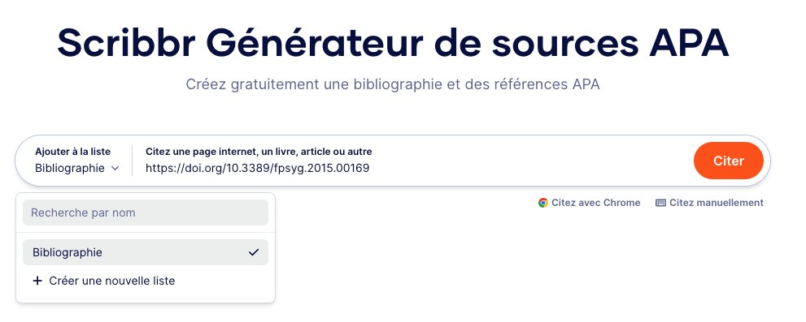{fig-align="center" width="100%" fig-alt="Barre de recherche de références de Scribbr, un générateur de sources aux normes APA."}

::: aside
[https://www.scribbr.fr/references/generateur/apa/](https://www.scribbr.fr/references/generateur/apa/){style="font-size:15px"}
:::

::: notes
– Sur Scribbr, il est également possible de mettre un lien sur un générateur des normes APA (en s’assurant qu’il s’agit bien de la version 7) et d’associer un article ou autre dans une « liste » (dans l’exemple ici, la liste s’appelle « Bibliographie »)

– DOI (digital object identifier) : littéralement « identifiant d'objet numérique » ; étiquette attachée à chaque ressource numérique (articles de périodique, livres, chapitres de livre, etc.)
:::

## Générateur aux normes APA {style="text-align: center;"}

:::::: columns
::: {.column width="67%"}
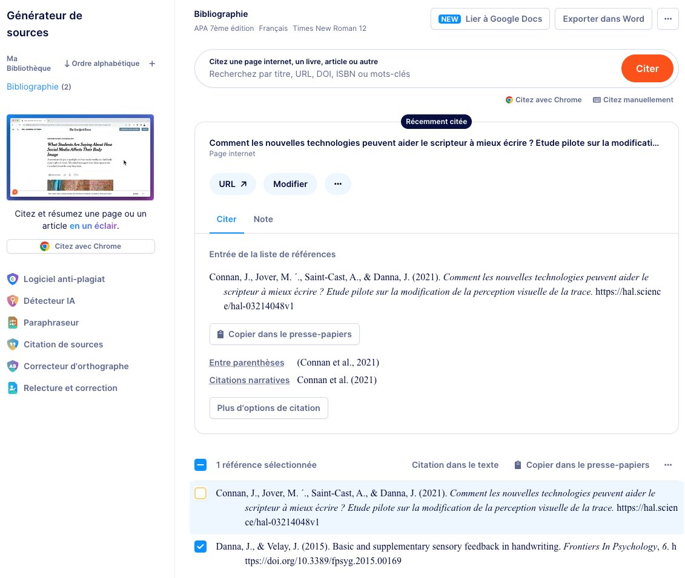{fig-align="center" width="100%" fig-alt="Interface de Scribbr, un générateur de sources aux normes APA."}
:::

::: {.column width="33%"}
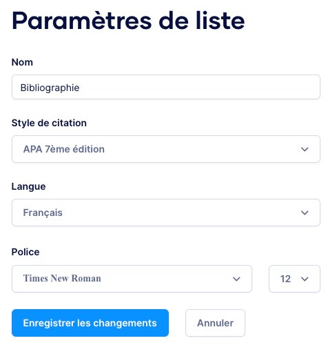{.fragment data-fragment-index="1" fig-align="center" width="100%" fig-alt="Interface de modification des paramètres de liste pour la bibliographie montée avec Scribbr, un générateur de sources aux normes APA."}
:::
::::::

::: aside
[https://www.scribbr.fr/references/generateur/apa/](https://www.scribbr.fr/references/generateur/apa/){style="font-size:15px"}
:::

::: notes
– Cette « liste » de références vous permet ensuite de générer une bibliographie en sélectionnant les références souhaitées, puis en les copiant dans votre presse-papiers et en les collant dans un fichier Word par exemple (en s’assurant que la mise en forme avec l’indexation à la deuxième ligne et l’interligne ne soient pas supprimées)

– Vous pouvez vérifier que les normes APA soient de la bonne version en regardant en-dessous de « Bibliographie » en haut ; pour modifier, il faut cliquer, c’est intuitif

– Vous remarquerez également que Scribbr propose d’autres fonctionnalités : logiciel anti-plagiat, détecteur IA, citation de sources, correcteur d’orthographe, etc. ; je ne connais pas bien ces fonctionnalités, je les ai découvertes en préparant ce cours (je n’utilise pas Scribbr), à vous de vous renseigner et de voir ce que vous préférez utiliser (toujours en vérifiant !)

– En plus de la citation dans la bibliographie, vous pouvez également sélectionner une référence et cliquer sur « Citation dans le texte » [diapositive suivante pour la suite]
:::

## Générateur aux normes APA {style="text-align: center;"}

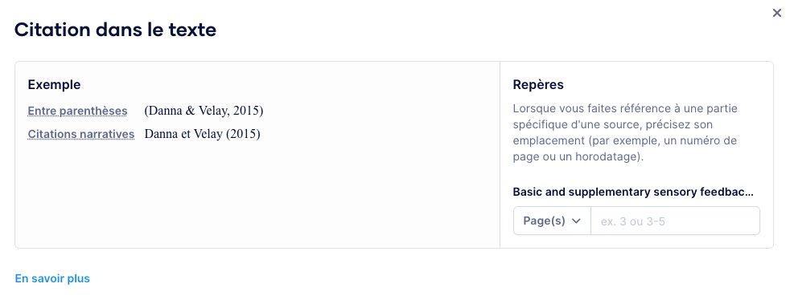{fig-align="center" width="100%" fig-alt="Exemples de citations dans le texte avec Scribbr, un générateur de sources aux normes APA."}

::: aside
[https://www.scribbr.fr/references/generateur/apa/](https://www.scribbr.fr/references/generateur/apa/){style="font-size:15px"}
:::

::: notes
– Cela vous permet de savoir comment citer dans le texte avec la forme entre parenthèses ou la forme narrative

– À un niveau d’expertise plus important, il est possible de relier Scribbr à un Google Docs (mais attention à la souveraineté des données)
:::

## Logiciel Zotero {style="text-align: center;"}

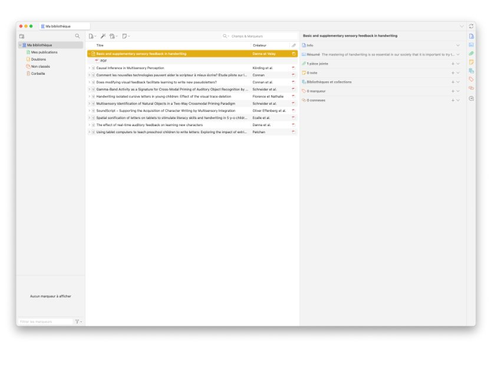{.fragment data-fragment-index="1" fig-align="center" width="70%" fig-alt="Interface de sélection d'un article dans le logiciel Zotero."}

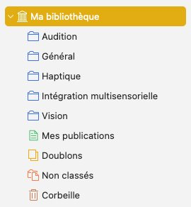{.fragment data-fragment-index="5" .absolute width="20%" left="5%" top="30%" fig-alt="Menu d'une Bibliothèque dans le logiciel Zotero."}

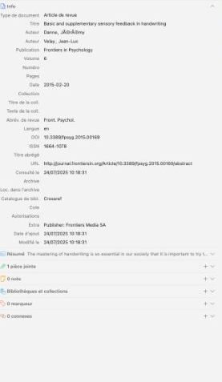{.absolute .fragment data-fragment-index="2" width="23%" right="20%" top="18%" fig-alt="Onglet de description d'un article dans le logiciel Zotero."}

{.fragment data-fragment-index="3" .absolute width="8%" right="5%" top="65%" fig-alt="Icône du pdf d'un article"}

{.fragment data-fragment-index="4" .absolute width="6%" right="8%" top="52%" fig-alt="Icône du pdf d'un article"}

::: aside
[https://www.zotero.org](https://www.zotero.org){style="font-size:15px"}
:::

::: notes
– Présenter à nouveau Sci-hub au besoin (en faisant de la « prévention » sur l’aspect « illégal » et sur comment Sci-hub est né – Sci-Hub est né en 2011 à l’initiative d’Alexandra Elbakyan, chercheuse kazakhe en neurosciences : le projet a été créé en réponse à la difficulté d’accès aux articles scientifiques, souvent verrouillés derrière des coûts imposés par des éditrices/éditeurs, l’objectif étant de rendre la recherche accessible à toutes et tous gratuitement indépendamment des moyens financiers ou de l’affiliation institutionnelle) ?

– Je ne suis pas expert du logiciel Zotero donc je vous illustre quelques possibilités non exhaustives sur le logiciel Zotero (pas sur la version en ligne), mais il y en a plein d’autres ; je vous laisse le choix de le prendre en main par vous-même, l’utilisation est plutôt intuitive

– C’est un logiciel compatible avec les principaux systèmes d’exploitation et les tablettes, mais vous pouvez également utiliser une version en ligne ; vous pouvez créer un compte et faire les deux et synchroniser vos données

– Pour simplifier, c’est un outil plutôt complet qui vous permet de classer et d’organiser vos articles/lectures tout en vous permettant d’avoir les informations essentielles presque automatiquement (p. ex. autrices/personnes, dates, revue)

– Attention, comme pour ChatGPT, il faut vérifier les informations données automatiquement car Zotero est susceptible de faire des erreurs ! J’aurais tendance à vous conseiller, d’abord, de vous entraîner un minimum à référencer vos sources à la main avec le manuel présenté précédemment pour avoir un niveau d’expertise suffisamment important pour vérifier ensuite ce que propose Zotero sans que cela ne vous demande trop d’efforts, ou mieux, de faire les 2 en parallèle

– Vous pouvez ajouter des dossiers, des sous-dossiers, des notes, des marqueurs, etc.

– 2 possibilités : soit vous faites glisser l’article que vous avez récupéré en format PDF, l’avantage est que vous aurez accès au PDF [diapositive suivante pour la suite]
:::

## Logiciel Zotero {style="text-align: center;"}

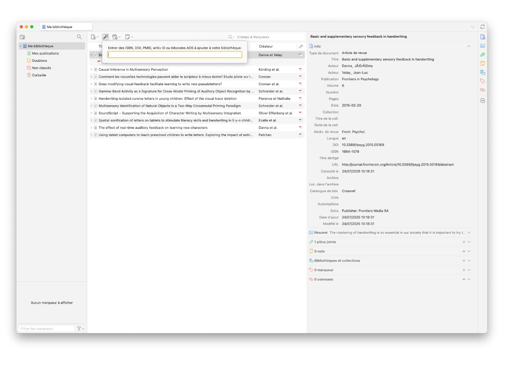{fig-align="center" width="70%" fig-alt="Interface de recherche d'un article dans le logiciel Zotero"}

{.absolute width="20%" left="5%" top="30%" fig-alt="Menu d'une Bibliothèque dans le logiciel Zotero."}

::: aside
[https://www.zotero.org](https://www.zotero.org){style="font-size:15px"}
:::

::: notes
– Soit vous référencez le lien ou le doi en cliquant sur l’emoji baguette magique (si l’article n’est pas trop récent), mais vous n’aurez évidemment pas accès au PDF depuis Zotero sans l’avoir glissé par vous-mêmes depuis votre ordinateur

– Dans ces deux cas, Zotero vous donne les principales informations dans « Infos » à droite
:::

## Logiciel Zotero {style="text-align: center;"}

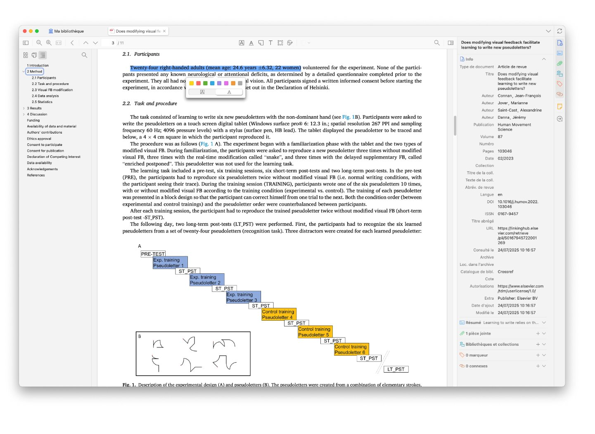{fig-align="center" width="70%" fig-alt="Interface de lecture d'un article dans le logiciel Zotero"}

::: aside
[https://www.zotero.org](https://www.zotero.org){style="font-size:15px"}
:::

::: notes
– Si vous avez le fichier PDF, en cliquant dessus, vous pouvez travailler directement sur l’article : selon les articles, Zotero peut même vous mettre le plan à gauche et vous pouvez cliquer pour accéder aux parties qui vous intéressent, de même que vous pouvez surligner les passages qui vous intéressent
:::

## Logiciel Zotero {style="text-align: center;"}

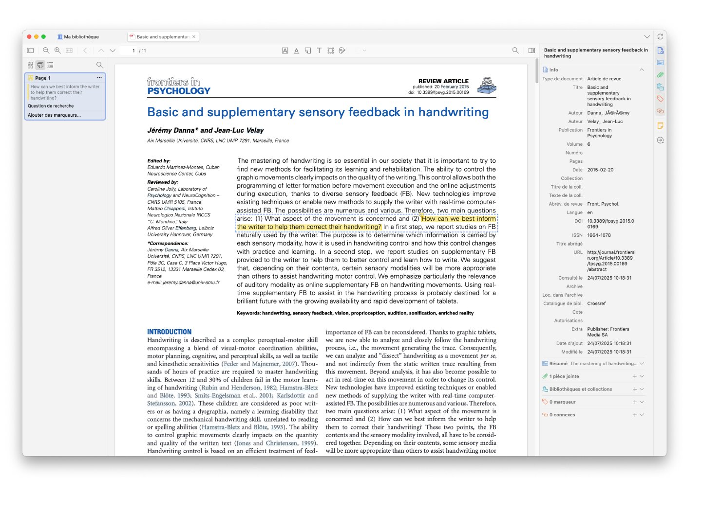{fig-align="center" width="70%" fig-alt="Interface d'anotation d'un article dans le logiciel Zotero"}

::: aside
[https://www.zotero.org](https://www.zotero.org){style="font-size:15px"}
:::

::: notes
– Vous pouvez également créer des notes sur les passages qui vous intéressent
:::

## Logiciel Zotero {style="text-align: center;"}

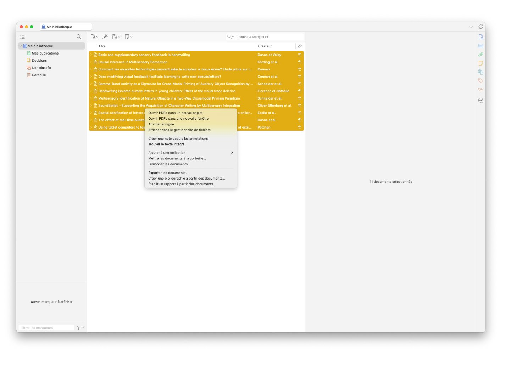{fig-align="center" width="70%" fig-alt="Sélection de documents dans le logiciel Zotero"}

::: aside
[https://www.zotero.org](https://www.zotero.org){style="font-size:15px"}
:::

::: notes
– Souvent, l’intérêt premier à utiliser Zotero est pour être aidé dans les références bibliographiques aux normes APA

– Pour qu’il vous génère une bibliographie aux normes que vous souhaitez, vous devez sélectionner les articles concernés [diapositive suivante pour la suite]
:::

## Logiciel Zotero {style="text-align: center;"}

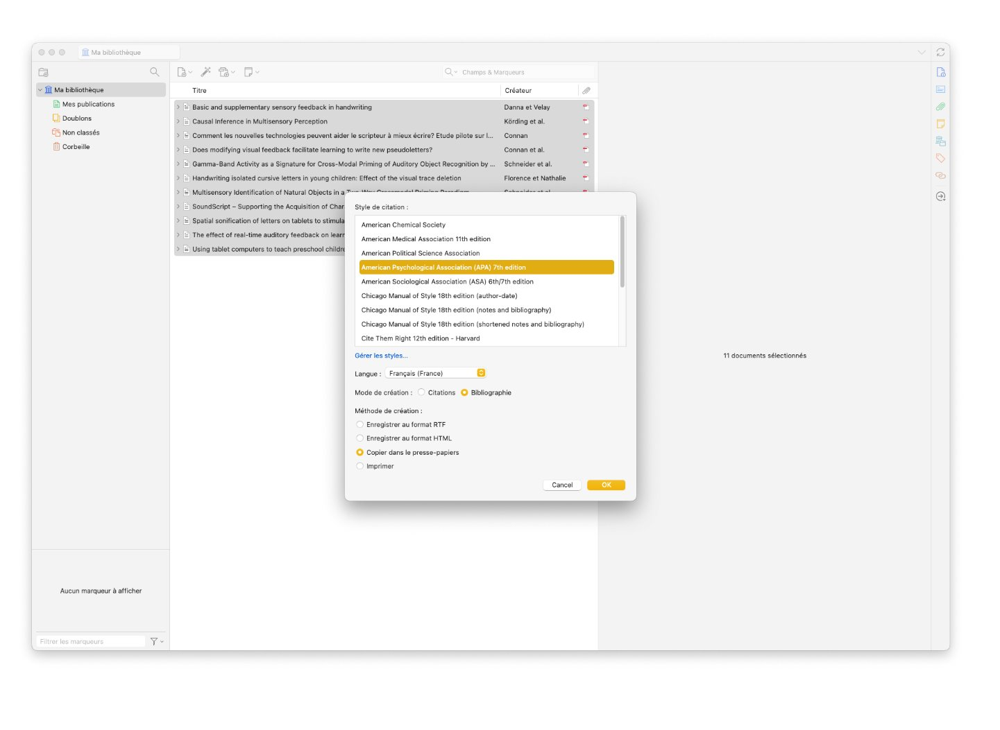{fig-align="center" width="70%" fig-alt="Sélection des normes de citations dans le logiciel Zotero"}

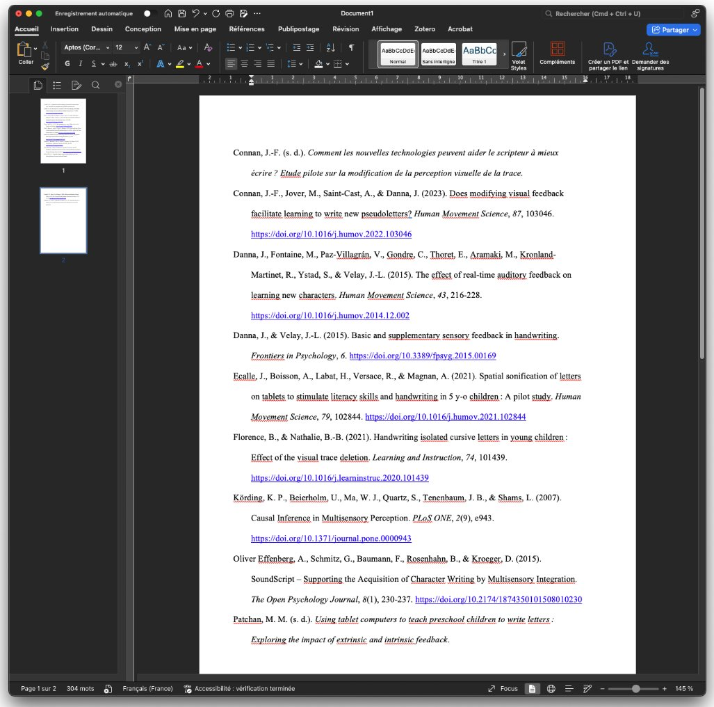{.fragment data-fragment-index="1" .absolute top="30%" right="0%" width="40%" fig-alt="Une bibliographie copiée-collée sur Word à l'aide du logiciel Zotero"}

::: {.fragment data-fragment-index="1" .absolute right="41.5%" bottom="12%" style="font-size:18px;"}
A copier/coller sur Word
:::

::: aside
[https://www.zotero.org](https://www.zotero.org){style="font-size:15px"}
:::

::: notes
– Ensuite, vous choisissez les normes que vous souhaitez, dans notre cas il s’agit des normes APA version 7 ; cela va copier la bibliographie générée dans votre presse-papiers

– Enfin, vous n’avez plus qu’à ouvrir un document Word ou autre (parfois cela ne fonctionne pas parfaitement bien, p. ex. sur Pages) et coller pour obtenir le résultat

– Une fois encore, attention, comme pour ChatGPT, il faut vérifier les informations données automatiquement car Zotero est susceptible de faire des erreurs !

– À un niveau d’expertise plus important, il est possible de relier Zotero à votre navigateur (il existe une extension Zotero) ainsi que de le relier à un fichier Word ou autre pour qu’il vous « automatise » en quelque sorte les citations dans le texte et dans la bibliographie

– C’est un outil de plus en plus précieux pour la recherche au fur et à mesure que vous avancerez dans votre cursus
:::

## Equation de recherche {style="text-align: center;"}

:::::: columns
::: {#vcenter .column width="20%"}
"**AND**"  
Sépare les mots-clés entre eux
:::

::: {.column width="60%"}
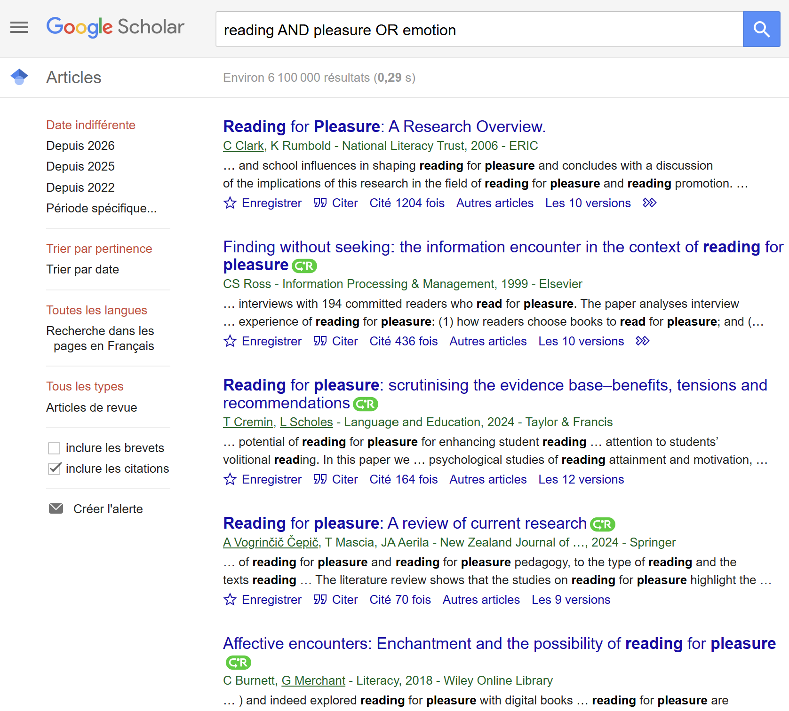{fig-align="center" width="100%" fig-alt="Un exemple de recherche documentaire sur Google Scholar : reading AND pleasure OR emotion"}
:::

::: {#vcenter .column width="20%"}
"**OR**"  
Permet d’associer un synonyme à un mot-clé
:::
::::::

::: notes
– Expliquer rapidement comment chercher des articles car dans le rapport de recherche elles/ils devront en ajouter en plus de ceux obligatoires

– Donner d’autres idées d’équation de recherche car celle affichée est très simple

– Il y a sur la page IRIS d’autres articles que ceux obligatoires que vous pourrez utiliser en plus

– Il y a également d’autres bases de données comme PsycInfo que vous aurez l’occasion de découvrir durant la formation Documen’TER pour le TER en L3 (je ne sais pas si ce n’est pas déjà accessible en L2 sur IRIS ?), c’est selon votre préférence (en l’occurence, ici, avec la même équation de recherche, les articles les plus pertinents apparaissaient en premier sur Google Scholar, mais pas sur PsycInfo)

– Il vaut mieux utiliser l’équation de recherche en anglais plutôt qu’en français car la majorité des articles du domaine sont en anglais

– Il y a des subtilités et des façons plus précises de chercher des articles, mais je ne rentrerai pas dans le détail dans le cadre de cette UE sauf si nécessaire

– Les articles en anglais restent des références davantage reconnues dans la plupart des domaines
:::

# Problématique

## Partageons les idées ! {style="text-align: center;"}

{fig-align="center" width="100%" fig-alt="Un QR code renvoyant vers un Padlet intitulé « brainstorming »"}  

[https://padlet.com/elichaput/py00302t-brainstorming](https://padlet.com/elichaput/py00302t-brainstorming-s024hz5did546d9nxapl)

## Lire de la poésie

Pourquoi lire pour le plaisir ?
-> cf bibliographie thème "lire pour le plaisir"

L'attrait de la poésie (le plaisir à la lecture d'un poème) pourrait-il résider dans son effet esthétique ?
-> oui (cf bibliographie thème "jugement esthétique et plaisir")

Comment traite-t-on un texte à sa lecture ?
-> cf bibliographie thème "traitement du discours et de la poésie"

Les tâches de lecture peuvent-elles impacter la façon dont est traité un texte ?
-> oui (cf bibliographie thème "tâches de lecture")

-> On peut donc supposer que les tâches de lecture impactent l'effet esthétique d'un poème ; quelles tâches pour maximiser l'appréciation esthétique ?

MAIS on pourrait théoriquement se poser d'autres questions : 
-> Comment optimiser la compréhension d'un texte (par les tâches de lecture) ?
-> Comment orienter l'attention d'un lecteur vers certains aspects du texte (par les tâches de lecture) ?
-> Etc.

::: aside
@creminReadingPleasureRecent2023; @sullivanReadingPleasureProgress2015; @sullivanVocabularyAdolescenceMiddle2015
:::

## 

::: notes
:::

# Clôture

## Objectifs par séance

::: {.absolute left="10.5%" top="24%" style="color:#2E8A48; font-size:18px; font-weight:bold;"}
Pour la séance 2
:::

::: {.absolute left="-10%" top="28%" style="color:#2E8A48; font-size:18px;"}
Lire les articles à l'aide (ou non) de la fiche de
:::

::: {.absolute left="-7%" top="32%" style="color:#2E8A48; font-size:18px;"}
lecture et avancer sur le rapport de synthèses
:::

::: {.absolute left="19.5%" top="36%" style="color:#2E8A48; font-size:20px; font-weight:bold;"}
\|
:::

::: {.absolute left="48%" top="5%" style="color:#5B748F; font-size:18px; font-weight:bold;"}
Pour la séance 4
:::

::: {.absolute left="34%" top="9%" style="color:#5B748F; font-size:18px;"}
Avancer sur le [rapport de recherche]{.light-blue} ([partie]{.light-blue}
:::

::: {.absolute left="34%" top="13%" style="color:#5B748F; font-size:18px;"}
[méthode]{.light-blue}) et terminer le recueil des données
:::

::: {.absolute left="59.5%" top="17.7%" style="color:#5B748F; font-size:20px; font-weight:bold;"}
\|\
\|\
\|\
\|\
\|
:::

::: {.absolute right="-6%" top="20%" style="color:#5B748F; font-size:18px; font-weight:bold;"}
Pour la semaine suivante
:::

::: {.absolute right="-16%" top="24%" style="color:#5B748F; font-size:18px;"}
Terminer le [rapport de recherche]{.light-blue} ([parties]{.light-blue}
:::

::: {.absolute right="-14%" top="28%" style="color:#5B748F; font-size:18px;"}
[discussion-conclusion]{.light-blue}, [bibliographie]{.light-blue},
:::

::: {.absolute right="-13.3%" top="32%" style="color:#5B748F; font-size:18px;"}
[résumé]{.light-blue}, [table des matières]{.light-blue}, [annexes]{.light-blue})
:::

::: {.absolute left="99%" top="36%" style="color:#5B748F; font-size:20px; font-weight:bold;"}
\|
:::

{.absolute .r-stretch left="0%" top="40%" width="100%" fig-alt="Une barre de progression remplie à 10% et partiellement remplie à 20%, jusqu'au travail requit pour la séance 2."}

::: {.absolute left="39.5%" top="62.5%" style="font-size:20px; font-weight:bold;"}
\|
:::

::: {.absolute left="24.8%" top="66.5%" style="font-size:18px; font-weight:bold;"}
Pour la séance 3
:::

::: {.absolute left="8%" top="70.5%" style="font-size:18px;"}
Terminer le [rapport de synthèses]{.light-blue} et avancer sur
:::

::: {.absolute left="11.2%" top="74.5%" style="font-size:18px;"}
le [rapport de recherche]{.light-blue} ([mise en forme du]{.light-blue}
:::

::: {.absolute left="9.1%" top="78.5%" style="font-size:18px;"}
[document]{.light-blue}, [page de garde]{.light-blue}, [partie introduction]{.light-blue})
:::

::: {.absolute left="9.1%" top="82.5%" style="font-size:18px;"}
et l'expérience (apporter le matériel en plus
:::

::: {.absolute left="11.8%" top="86.5%" style="font-size:18px;"}
nécessaire pour construire l'expérience)
:::

::: {.absolute left="79.3%" top="62.5%" style="color:#5B748F; font-size:20px; font-weight:bold;"}
\|
:::

::: {.absolute left="78%" top="66.5%" style="color:#5B748F; font-size:18px; font-weight:bold;"}
Pour la séance 5
:::

::: {.absolute right="-5%" top="70.5%" style="color:#5B748F; font-size:18px;"}
Avancer sur le [rapport de recherche]{.light-blue}
:::

::: {.absolute left="77%" top="74.5%" style="color:#5B748F; font-size:18px;"}
(partie [résultats]{.light-blue})
:::

##  {.dark-theme .center style="text-align:center;"}

Remerciements pour la construction de ces contenus de cours à

**YOAN SEGURA**

**AURÉLIE PISTONO**

**MAGALI BRINGUIER**

**ZOÉ LACROUX**

## Références {.dark-theme style="font-size:15px;"}

::: {#refs}
:::