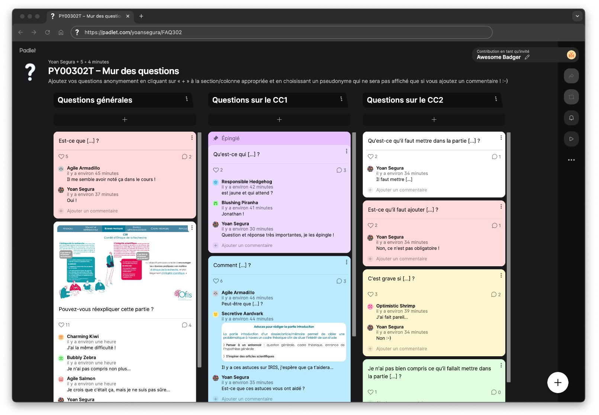
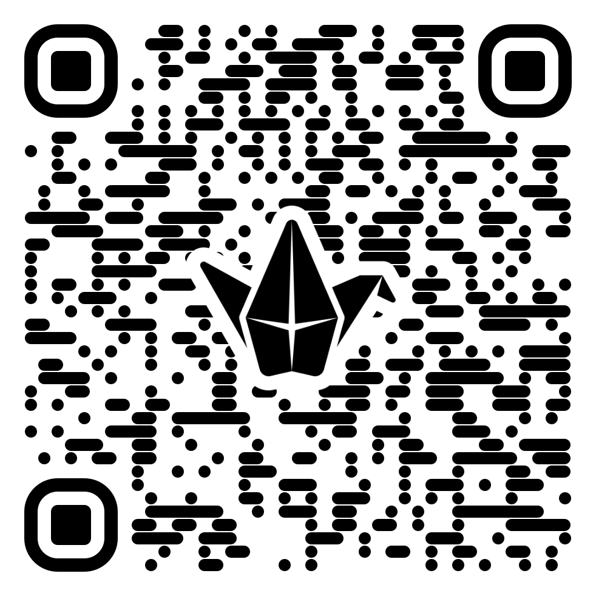
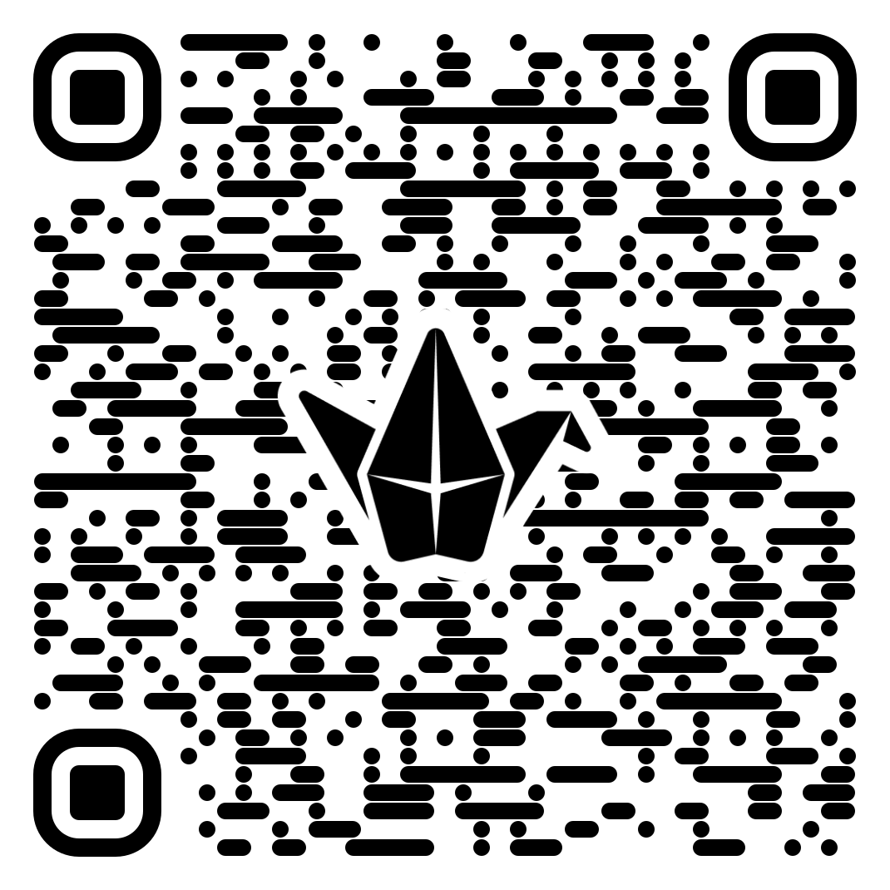
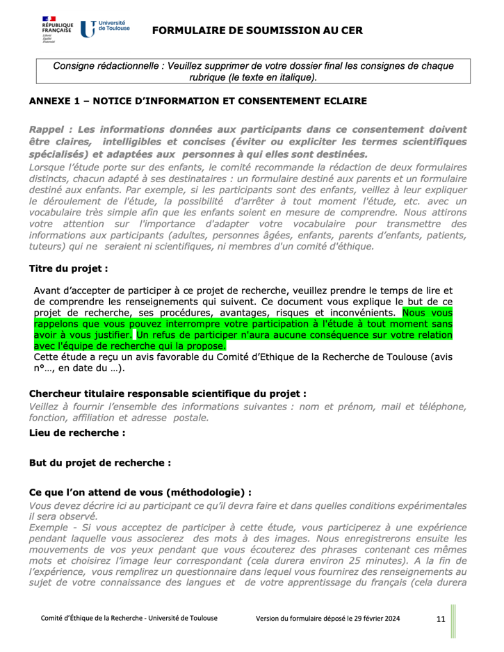
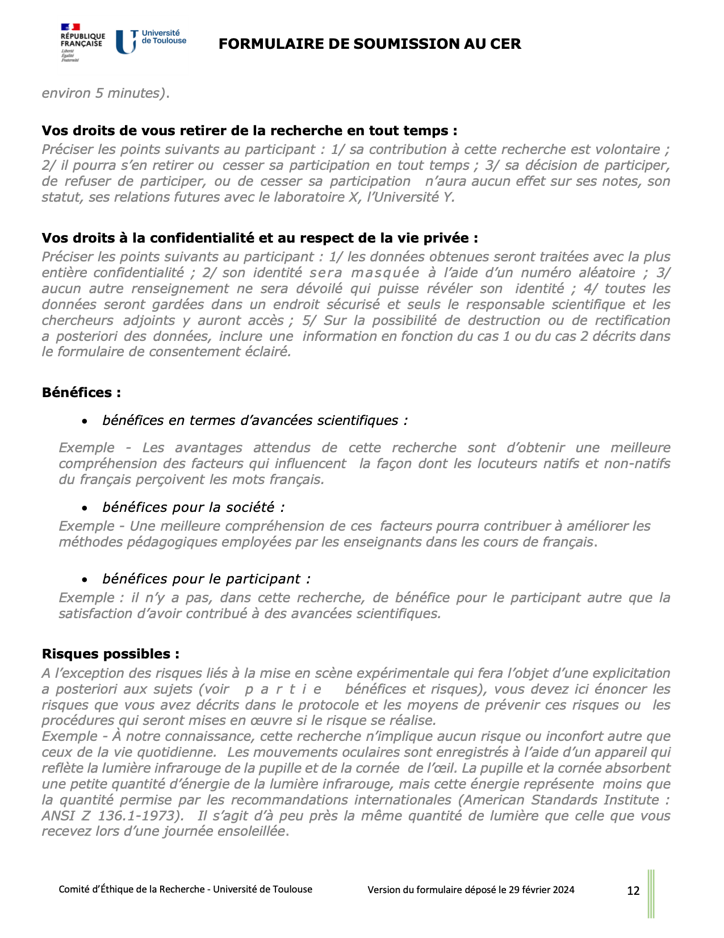
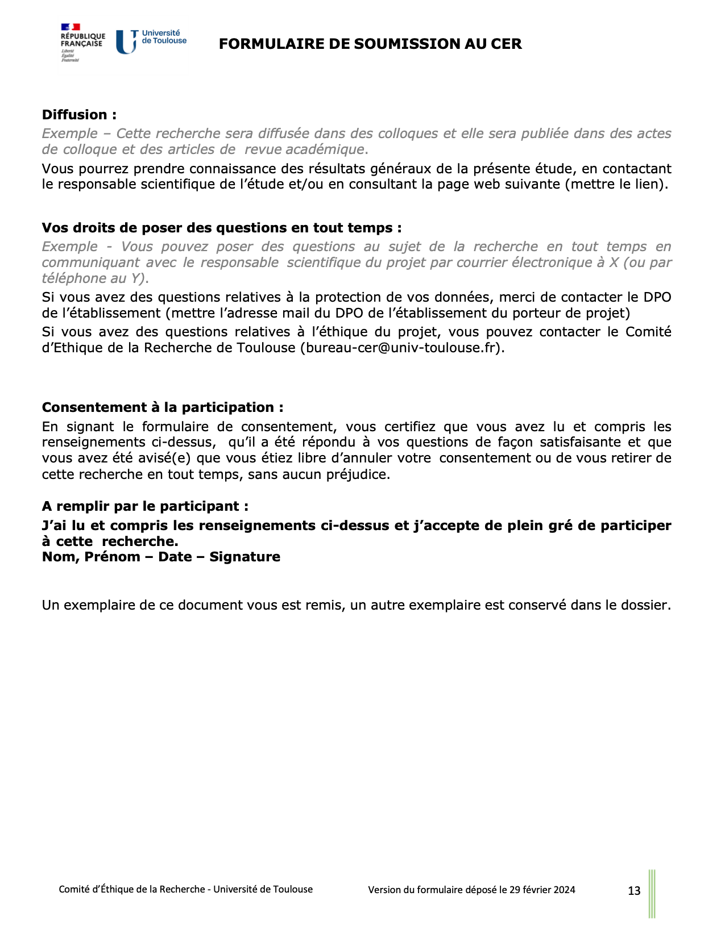

# Organisation

## Le mur des questions

::: r-stack
[padlet.com/elichaput/PY00302T](https://padlet.com/elichaput/py00302t-mur-des-questions-5wr05uxj8nlbdqa0){style="font-size:20px;"}
:::

{fig-align="center" width="75%" fig-alt="Un Padlet intitulé « mur des questions »"}

{.absolute top="45%" right="-10%" width="15%" fig-alt="Un QR code renvoyant vers le même Padlet que le lien."}

## Objectifs par séance

::: {.absolute left="10.5%" top="24%" style="color:#2E8A48; font-size:18px; font-weight:bold;"}
Pour la séance 2
:::

::: {.absolute left="-10%" top="28%" style="color:#2E8A48; font-size:18px;"}
Lire les articles à l'aide (ou non) de la fiche de
:::

::: {.absolute left="-7%" top="32%" style="color:#2E8A48; font-size:18px;"}
lecture et avancer sur le rapport de synthèses
:::

::: {.absolute left="19.5%" top="36%" style="color:#2E8A48; font-size:20px; font-weight:bold;"}
\|
:::

::: {.absolute left="48%" top="5%" style="color:#5B748F; font-size:18px; font-weight:bold;"}
Pour la séance 4
:::

::: {.absolute left="34%" top="9%" style="color:#5B748F; font-size:18px;"}
Avancer sur le [rapport de recherche]{.light-blue} ([partie]{.light-blue}
:::

::: {.absolute left="34%" top="13%" style="color:#5B748F; font-size:18px;"}
[méthode]{.light-blue}) et terminer le recueil des données
:::

::: {.absolute left="59.5%" top="17.7%" style="color:#5B748F; font-size:20px; font-weight:bold;"}
\|\
\|\
\|\
\|\
\|
:::

::: {.absolute right="-6%" top="20%" style="color:#5B748F; font-size:18px; font-weight:bold;"}
Pour la semaine suivante
:::

::: {.absolute right="-16%" top="24%" style="color:#5B748F; font-size:18px;"}
Terminer le [rapport de recherche]{.light-blue} ([parties]{.light-blue}
:::

::: {.absolute right="-14%" top="28%" style="color:#5B748F; font-size:18px;"}
[discussion-conclusion]{.light-blue}, [bibliographie]{.light-blue},
:::

::: {.absolute right="-13.3%" top="32%" style="color:#5B748F; font-size:18px;"}
[résumé]{.light-blue}, [table des matières]{.light-blue}, [annexes]{.light-blue})
:::

::: {.absolute left="99%" top="36%" style="color:#5B748F; font-size:20px; font-weight:bold;"}
\|
:::

{.absolute .r-stretch left="0%" top="40%" width="100%" fig-alt="Une barre de progression remplie à 10%, avant le travail requit pour la séance 2."}

::: {.absolute left="39.5%" top="62.5%" style="color:#2E8A48; font-size:20px; font-weight:bold;"}
\|
:::

::: {.absolute left="24.8%" top="66.5%" style="color:#2E8A48; font-size:18px; font-weight:bold;"}
Pour la séance 3
:::

::: {.absolute left="8%" top="70.5%" style="color:#2E8A48; font-size:18px;"}
Terminer le rapport de synthèses et avancer sur
:::

::: {.absolute left="11.2%" top="74.5%" style="color:#2E8A48; font-size:18px;"}
le rapport de recherche (mise en forme du
:::

::: {.absolute left="9.1%" top="78.5%" style="color:#2E8A48; font-size:18px;"}
document, page de garde, partie introduction)
:::

::: {.absolute left="9.1%" top="82.5%" style="color:#2E8A48; font-size:18px;"}
et l'expérience (apporter le matériel en plus
:::

::: {.absolute left="11.8%" top="87.5%" style="color:#2E8A48; font-size:18px;"}
nécessaire pour construire l'expérience)
:::

::: {.absolute left="79.3%" top="62.5%" style="color:#5B748F; font-size:20px; font-weight:bold;"}
\|
:::

::: {.absolute left="78%" top="66.5%" style="color:#5B748F; font-size:18px; font-weight:bold;"}
Pour la séance 5
:::

::: {.absolute right="-5%" top="70.5%" style="color:#5B748F; font-size:18px;"}
Avancer sur le [rapport de recherche]{.light-blue}
:::

::: {.absolute left="77%" top="74.5%" style="color:#5B748F; font-size:18px;"}
(partie [résultats]{.light-blue})
:::

# Recrutement des participants

## Partageons les idées ! {style="text-align: center;"}

{fig-align="center" width="100%" fig-alt="Un QR code renvoyant vers un Padlet intitulé « brainstorming »"} 

## Critères d'inclusion et de non-inclusion {.smaller style="text-align: center;"}

:::::: columns
::: {.column width="50%"}
[**Critères d’inclusion**]{.blue}

**Définition**  
[Caractéristiques que les participantes/participants doivent avoir pour être inclus-es]{.blue} dans l’étude

**Exemples**  
Âge entre 18 et 35 ans  
Diagnostic Y  
Consentement libre et éclairé signé
:::

::: {.column width="50%"}
[**Critères de non-inclusion**]{.blue}

**Définition**  
[Caractéristiques qui, si elles sont présentes, empêchent les participantes/participants d’être inclus-es]{.blue} dans l’étude, même si les critères d’inclusion sont remplis

**Exemples**  
Trouble neurologique  
Antécédents médicaux  
Sportive/Sportif de haut niveau
:::
:::::: 

::: notes
– Ne pas être trop restrictif dans ces critères pour généraliser vos effets au mieux

– Critères de non-inclusion sont parfois appelés critères d’exclusion, c’est subtile, il s’agit plutôt de critères définis a posteriori selon les résultats observés (p. ex. valeurs aberrantes) qui conduisent à l’exclusion des données d’une participante/un participant de l’étude

– Pensez à la tranche d’âge que vous souhaitez, notamment à travers la littérature (p. ex. trouver des articles sur des tâches similaires qui comparent les différences entre hommes et femmes ; vérifier également s’il s’agit du sexe biologique ou du genre social et pourquoi ?)
::: 

## Notice d'information & Consentement libre et éclairé {.smaller style="text-align: center"}

**Essentiels** pour informer et s’assurer de l’accord des participantes/participants

:::::::: columns
::: {.column width="30%"}
{fig-alt="Ethique de la recherche"}
:::

::: {.column width="5%"}
:::

::: {.column width="30%"}
{fig-alt="Integrité scientifique"}
:::

::: {.column width="5%"}
:::

::: {.column width="30%"}
{fig-alt="Integrité scientifique"} [À ajouter pour un formulaire parfait : le droit d’introduire une réclamation à la CNIL + la durée de conservation]{.absolute left="73%" right="3%" top="60%" bottom="19%" style="font-size:12px; font-weight=lighter"}
:::
::::::::

::: aside
[https://www.univ-toulouse.fr/actualites/comite-d-ethique-de-recherche-cer](https://www.univ-toulouse.fr/actualites/comite-d-ethique-de-recherche-cer){style="font-size:15px"}
:::

## Questionnaire socio-démographique

::: notes
– Je vous conseille de toujours mettre dans les propositions « Je ne souhaite pas répondre »

– Le questionnaire socio-démographique doit reprendre des informations descriptives pertinentes pour décrire votre échantillon ainsi que vos critères d’inclusion et de non-inclusion ; si une ou plusieurs cases qui comportent des critères de non-inclusion sont cochées, les résultats de la personne ne pourront pas être inclus dans l’étude, de même pour les cases « Je ne souhaite pas répondre »

– Il est inutile d’en faire un très exhaustif s’il n’y a pas de pertinence/d’objectifs derrière, le mieux du point de vue du RGPD est d’en demander le moins possible pour protéger le plus possible l’anonymat

– Certains critères ne sont pas utiles à ajouter : avant, j’avais tendance à demander le niveau de français pour m’assurer de la compréhension des consignes, mais ce n’est pas utile car vous voyez rapidement si une participante/un participant a compris ou non la tâche et il y a souvent des phases de familiarisation pour les aider à appréhender le matériel ; en revanche, le niveau de français peut être important à demander dans des tâches langagières

– Il peut être proposé au début ou à la fin selon ce que vous jugez le plus pertinent pour limiter les biais expérimentaux liés à la désirabilité sociale ou à la fatigue cognitive

– Remarque : une astuce à la fois pour simplifier le questionnaire socio-démographique, pour ne pas mettre en inconfort la participante/le participant et pour préserver le plus possible son anonymat, consiste à faire une énumération de tous les critères de non-inclusion plutôt qu’une case à cocher par critère

– Remarque bis : de la même façon, une autre astuce consiste à demander l’année de naissance plutôt que la date de naissance

– Remarque bis bis : si vous souhaitez demander le sexe biologique ou le genre social, vous devez au préalable vous demander s’il pourrait éventuellement y avoir une différence relative au sexe biologique (p. ex. mesures physiologiques) ou au genre social afin de contrôler cette variable correctement

– Remarque bis bis bis : thymique = de l’humeur
::: 

# Méthodologie

# Clôture

## Objectifs par séance

::: {.absolute left="10.5%" top="24%" style="color:#2E8A48; font-size:18px; font-weight:bold;"}
Pour la séance 2
:::

::: {.absolute left="-10%" top="28%" style="color:#2E8A48; font-size:18px;"}
Lire les articles à l'aide (ou non) de la fiche de
:::

::: {.absolute left="-7%" top="32%" style="color:#2E8A48; font-size:18px;"}
lecture et avancer sur le rapport de synthèses
:::

::: {.absolute left="19.5%" top="36%" style="color:#2E8A48; font-size:20px; font-weight:bold;"}
\|
:::

::: {.absolute left="48%" top="5%" style="font-size:18px; font-weight:bold;"}
Pour la séance 4
:::

::: {.absolute left="34%" top="9%" style="font-size:18px;"}
Avancer sur le [rapport de recherche]{.light-blue} ([partie]{.light-blue}
:::

::: {.absolute left="34%" top="13%" style="font-size:18px;"}
[méthode]{.light-blue}) et terminer le recueil des données
:::

::: {.absolute left="59.5%" top="17.7%" style="color:#5B748F; font-size:20px; font-weight:bold;"}
\|\
\|\
\|\
\|\
\|
:::

::: {.absolute right="-6%" top="20%" style="color:#5B748F; font-size:18px; font-weight:bold;"}
Pour la semaine suivante
:::

::: {.absolute right="-16%" top="24%" style="color:#5B748F; font-size:18px;"}
Terminer le [rapport de recherche]{.light-blue} ([parties]{.light-blue}
:::

::: {.absolute right="-14%" top="28%" style="color:#5B748F; font-size:18px;"}
[discussion-conclusion]{.light-blue}, [bibliographie]{.light-blue},
:::

::: {.absolute right="-13.3%" top="32%" style="color:#5B748F; font-size:18px;"}
[résumé]{.light-blue}, [table des matières]{.light-blue}, [annexes]{.light-blue})
:::

::: {.absolute left="99%" top="36%" style="color:#5B748F; font-size:20px; font-weight:bold;"}
\|
:::

{.absolute .r-stretch left="0%" top="40%" width="100%" fig-alt="Une barre de progression remplie à 10% et partiellement remplie à 20%, jusqu'au travail requit pour la séance 2."}

::: {.absolute left="39.5%" top="62.5%" style="color:#2E8A48; font-size:20px; font-weight:bold;"}
\|
:::

::: {.absolute left="24.8%" top="66.5%" style="color:#2E8A48; font-size:18px; font-weight:bold;"}
Pour la séance 3
:::

::: {.absolute left="8%" top="70.5%" style="color:#2E8A48; font-size:18px;"}
Terminer le rapport de synthèses et avancer sur
:::

::: {.absolute left="11.2%" top="74.5%" style="color:#2E8A48; font-size:18px;"}
le rapport de recherche (mise en forme du
:::

::: {.absolute left="9.1%" top="78.5%" style="color:#2E8A48; font-size:18px;"}
document, page de garde, partie introduction)
:::

::: {.absolute left="9.1%" top="82.5%" style="color:#2E8A48; font-size:18px;"}
et l'expérience (apporter le matériel en plus
:::

::: {.absolute left="11.8%" top="86.5%" style="color:#2E8A48; font-size:18px;"}
nécessaire pour construire l'expérience)
:::

::: {.absolute left="79.3%" top="62.5%" style="color:#5B748F; font-size:20px; font-weight:bold;"}
\|
:::

::: {.absolute left="78%" top="66.5%" style="color:#5B748F; font-size:18px; font-weight:bold;"}
Pour la séance 5
:::

::: {.absolute right="-5%" top="70.5%" style="color:#5B748F; font-size:18px;"}
Avancer sur le [rapport de recherche]{.light-blue}
:::

::: {.absolute left="77%" top="74.5%" style="color:#5B748F; font-size:18px;"}
(partie [résultats]{.light-blue})
:::

##  {.dark-theme .center style="text-align:center;"}

Remerciements pour la construction de ces contenus de cours à

**YOAN SEGURA**

**AURÉLIE PISTONO**

**MAGALI BRINGUIER**

**ZOÉ LACROUX**