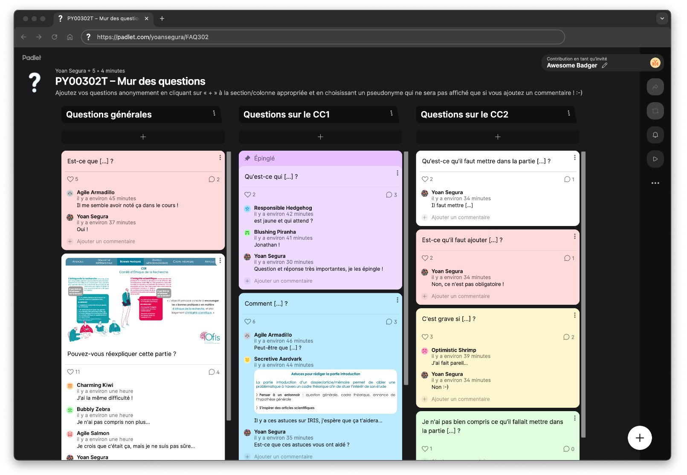

# Organisation

## Le mur des questions

::: r-stack
[padlet.com/elichaput/PY00302T](https://padlet.com/elichaput/py00302t-mur-des-questions-5wr05uxj8nlbdqa0){style="font-size:20px;"}
:::

{fig-align="center" width="75%" fig-alt="Un Padlet intitulé « mur des questions »"}

{.absolute top="45%" right="-10%" width="15%" fig-alt="Un QR code renvoyant vers le même Padlet que le lien."}

## Objectifs par séance

::: {.absolute left="10.5%" top="24%" style="color:#2E8A48; font-size:18px; font-weight:bold;"}
Pour la séance 2
:::

::: {.absolute left="-10%" top="28%" style="color:#2E8A48; font-size:18px;"}
Lire les articles à l'aide (ou non) de la fiche de
:::

::: {.absolute left="-7%" top="32%" style="color:#2E8A48; font-size:18px;"}
lecture et avancer sur le rapport de synthèses
:::

::: {.absolute left="19.5%" top="36%" style="color:#2E8A48; font-size:20px; font-weight:bold;"}
\|
:::

::: {.absolute left="48%" top="5%" style="color:#2E8A48; font-size:18px; font-weight:bold;"}
Pour la séance 4
:::

::: {.absolute left="34%" top="9%" style="color:#2E8A48; font-size:18px;"}
Avancer sur le rapport de recherche (partie
:::

::: {.absolute left="34%" top="13%" style="color:#2E8A48; font-size:18px;"}
méthode) et terminer le recueil des données
:::

::: {.absolute left="59.5%" top="17.7%" style="color:#2E8A48; font-size:20px; font-weight:bold;"}
\|\
\|\
\|\
\|\
\|
:::

::: {.absolute right="-6%" top="20%" style="color:#5B748F; font-size:18px; font-weight:bold;"}
Pour la semaine suivante
:::

::: {.absolute right="-16%" top="24%" style="color:#5B748F; font-size:18px;"}
Terminer le [rapport de recherche]{.light-blue} ([parties]{.light-blue}
:::

::: {.absolute right="-14%" top="28%" style="color:#5B748F; font-size:18px;"}
[discussion-conclusion]{.light-blue}, [bibliographie]{.light-blue},
:::

::: {.absolute right="-13.3%" top="32%" style="color:#5B748F; font-size:18px;"}
[résumé]{.light-blue}, [table des matières]{.light-blue}, [annexes]{.light-blue})
:::

::: {.absolute left="99%" top="36%" style="color:#5B748F; font-size:20px; font-weight:bold;"}
\|
:::

{.absolute .r-stretch left="0%" top="40%" width="100%" fig-alt="Une barre de progression remplie à 10%, avant le travail requit pour la séance 2."}

::: {.absolute left="39.5%" top="62.5%" style="color:#2E8A48; font-size:20px; font-weight:bold;"}
\|
:::

::: {.absolute left="24.8%" top="66.5%" style="color:#2E8A48; font-size:18px; font-weight:bold;"}
Pour la séance 3
:::

::: {.absolute left="8%" top="70.5%" style="color:#2E8A48; font-size:18px;"}
Terminer le rapport de synthèses et avancer sur
:::

::: {.absolute left="11.2%" top="74.5%" style="color:#2E8A48; font-size:18px;"}
le rapport de recherche (mise en forme du
:::

::: {.absolute left="9.1%" top="78.5%" style="color:#2E8A48; font-size:18px;"}
document, page de garde, partie introduction)
:::

::: {.absolute left="9.1%" top="82.5%" style="color:#2E8A48; font-size:18px;"}
et l'expérience (apporter le matériel en plus
:::

::: {.absolute left="11.8%" top="87.5%" style="color:#2E8A48; font-size:18px;"}
nécessaire pour construire l'expérience)
:::

::: {.absolute left="79.3%" top="62.5%" style="color:#5B748F; font-size:20px; font-weight:bold;"}
\|
:::

::: {.absolute left="78%" top="66.5%" style="color:#5B748F; font-size:18px; font-weight:bold;"}
Pour la séance 5
:::

::: {.absolute right="-5%" top="70.5%" style="color:#5B748F; font-size:18px;"}
Avancer sur le [rapport de recherche]{.light-blue}
:::

::: {.absolute left="77%" top="74.5%" style="color:#5B748F; font-size:18px;"}
(partie [résultats]{.light-blue})
:::

# Rappels méthodologiques

## Variables indépendantes {.smaller style="font-size:15px;"}

### 3 critères pour les définir

::: {.absolute right="0%" top="5%" style="color:#006DA3; font-size:15px;"}
[VI]{.purple style="font-weight:bold;"} agit sur [VD]{.gold style="font-weight:bold;"} et varie
:::

::: {.absolute right="0%" top="8.5%" style="color:#006DA3; font-size:15px;"}
2 modalités minimum
:::

::::: columns
::: {.column width="16%"}
[Valeurs de la]{.red style="font-weight:bold;"} [VI]{.purple style="font-weight:bold;"}
:::

::: {.column .fragment .fade-in-then-semi-out data-fragment-index="1" width="84%"}
[Modalités]{.red style="font-weight:bold;"}

[Définition]{style="font-weight:bold;"} : correspondent aux [valeurs que peut prendre la]{.red} [VI]{.purple style="font-weight:bold;"}

[Exemple]{style="font-weight:bold;"} : la VI "difficulté de la tâche" peut prendre 2 valeurs - "facile" et "difficile" ; elle a donc deux modalités
:::
:::::

:::::: columns
::: {.column width="16%"}
[Type de la]{.magenta style="font-weight:bold;"} [VI]{.purple style="font-weight:bold;"}
:::

::: {.column .fragment .fade-in-then-semi-out data-fragment-index="2" width="42%"}
[Intra-sujets/Intragroupe]{.magenta style="font-weight:bold;"}

[Définition]{style="font-weight:bold;"} : les participantes/participants [passent par toutes les modalités/conditions]{.magenta} de la [VI]{.purple style="font-weight:bold;"}

[Exemple]{style="font-weight:bold;"} : les participantes/participants vont toutes/tous effectuer la tâche en condition facile ET en condition difficile
:::

::: {.column .fragment .fade-in-then-semi-out data-fragment-index="2" width="42%"}
[Inter-sujets/Intergroupes]{.magenta style="font-weight:bold;"}

[Définition]{style="font-weight:bold;"} : les participantes/participants sont [réparti-es en groupes en fonction des modalités]{.magenta} (autant de groupes que de modalités) et [ne passent qu’une modalité/condition]{.magenta} de la [VI]{.purple style="font-weight:bold;"}

[Exemple]{style="font-weight:bold;"} : les participantes/participants vont effectuer la tâche en condition facile [OU]{.magenta} en condition difficile
:::
::::::

:::::: columns
::: {.column width="16%"}
[Nature de la]{.pink style="font-weight:bold;"} [VI]{.purple style="font-weight:bold;"}
:::

::: {.column .fragment .fade-in-then-semi-out data-fragment-index="3" width="42%"}
[Invoquée]{.pink style="font-weight:bold;"}

[Définition]{style="font-weight:bold;"} : l’expérimentatrice/expérimentateur [ne peut pas directement manipuler]{.pink} la [VI]{.purple style="font-weight:bold;"} car elle est inhérente aux participantes/participants (p. ex. âge, genre)
:::

::: {.column .fragment .fade-in-then-semi-out data-fragment-index="3" width="42%"}
[Provoquée]{.pink style="font-weight:bold;"}

[Définition]{style="font-weight:bold;"} : l’expérimentatrice/expérimentateur [manipule directement]{.pink} la [VI]{.purple style="font-weight:bold;"} (p. ex. difficulté d’une tâche – facile vs. difficile)
:::
::::::

## Variables dépendantes {.smaller style="font-size:17px;"}

### Caractéristiques métriques déduites à partir des échelles de mesure

::::: columns
::: {.column width="14%"}
[Echelle nominale]{.dark-blue style="font-weight:bold;"}
:::

::: {.column .fragment .fade-in-then-semi-out data-fragment-index="1" width="86%"}
[Objectif]{style="font-weight:bold;"} : pour les variables dont les [modalités]{.red} [ne peuvent pas être ordonnées]{.dark-blue}

[Exemples]{style="font-weight:bold;"} : genre, couleur, profession...

↳ [Indice de tendance centrale]{style="font-weight:bold;"} : [mode]{.dark-blue} \| [Indice de dispersion]{style="font-weight:bold;"} : [étendue]{.dark-blue}
:::
:::::

::::: columns
::: {.column width="14%"}
[Echelle ordinale]{.teal style="font-weight:bold;"}
:::

::: {.column .fragment .fade-in-then-semi-out data-fragment-index="2" width="86%"}
[Objectif]{style="font-weight:bold;"} : pour les variables dont les [modalités]{.red} [peuvent être ordonnées]{.teal}

[Exemples]{style="font-weight:bold;"} : taille (petit, moyen, grand), échelle de Likert (de « pas du tout d’accord » à « tout à fait d’accord)...

↳ [Indice de tendance centrale]{style="font-weight:bold;"} : [médiane]{.teal} \| [Indice de dispersion]{style="font-weight:bold;"} : [écart interquartile]{.teal}
:::
:::::

::::: columns
::: {.column width="14%"}
[Echelle d'intervalle]{.green style="font-weight:bold;"}
:::

::: {.column .fragment .fade-in-then-semi-out data-fragment-index="3" width="86%"}
[Objectif]{style="font-weight:bold;"} : pour les variables dont les [modalités]{.red} [peuvent être ordonnées]{.green} et dont l'[écart entre les modalités est égal]{.green}

[Exemples]{style="font-weight:bold;"} : température Celsius, note à un examen, score de mémoire...

↳ [Indice de tendance centrale]{style="font-weight:bold;"} : [moyenne]{.green} \| [Indice de dispersion]{style="font-weight:bold;"} : [écart-type]{.green} ou [variance]{.green}
:::
:::::

[Le type d’échelle contribue à définir les statistiques à réaliser par la suite]{.highlighted-light}

# Analyses statistiques

## Analyses descriptives vs. inférentielles {.smaller style="text-align: center;"}

::::: columns
::: {.column .fragment data-fragment-index="1" width="50%"}
[Analyses descriptives]{.blue style="font-weight:bold;"}

**Définition**  
Descriptions résumées/synthétiques des données
:::

::: {.column .fragment data-fragment-index="4" width="50%"}
[Analyses inférentielles]{.blue style="font-weight:bold;"}

**Définition**  
Estimations de l’existence d’effets n’étant pas liés au hasard
:::
:::::

::::: columns
::: {.column .fragment data-fragment-index="2" width="25%"}
[Indices de dispersion]{.blue style="font-weight:bold;"}

**Définition**  
Valeurs qui mesurent la variabilité / l’hétérogénéité des données

[Étendue]{.dark-blue} | [Écart interquartile]{.teal} | [Écart-type & Variance]{.green}
:::

::: {.column .fragment data-fragment-index="3" width="25%"}
[Indices de tendance centrale]{.blue style="font-weight:bold;"}

**Définition**  
Valeurs qui résument la distribution des données

[Mode]{.dark-blue} | [Médiane]{.teal} | [Moyenne]{.green}
:::

::: {.column .fragment data-fragment-index="5" width="25%"}
[Tests non-paramétriques]{.blue style="font-weight:bold;"}

**Utilisation**  
Ne supposent pas une distribution particulière des données et donc nécessitent généralement peu de pré-requis

[Moins "puissants"]{style="font-weight:lighter;"}
:::

::: {.column .fragment data-fragment-index="6" width="25%"}
[Tests paramétriques]{.blue style="font-weight:bold;"}

**Utilisation**  
Supposent une distribution particulière des données et donc nécessitent des pré-requis (souvent la loi normale)

[Plus "puissants"]{style="font-weight:lighter;"}
:::
:::::

## Analyses descriptives vs. inférentielles {.smaller style="text-align: center;"}

::::: columns
::: {.column width="50%"}
[Analyses descriptives]{.blue style="font-weight:bold;"}

**Définition**  
Descriptions résumées/synthétiques des données
:::

::: {.column width="50%"}
[Analyses inférentielles]{.blue style="font-weight:bold;"}

**Définition**  
Estimations de l’existence d’effets n’étant pas liés au hasard
:::
:::::

::::: columns
::: {.column width="25%"}
[Indices de dispersion]{.blue style="font-weight:bold;"}

**Définition**  
Valeurs qui mesurent la variabilité / l’hétérogénéité des données

[Étendue]{.dark-blue} | [Écart interquartile]{.teal} | [Écart-type & Variance]{.green}
:::

::: {.column width="25%"}
[Indices de tendance centrale]{.blue style="font-weight:bold;"}

**Définition**  
Valeurs qui résument la distribution des données

[Mode]{.dark-blue} | [Médiane]{.teal} | [Moyenne]{.green}
:::

::: {.column width="25%"}
[**Hypothèse nulle** (H0)]{.blue}

Il **n'existe pas de relation** entre les variables
:::

::: {.column width="25%"}
[**Hypothèse alternative** (H1)]{.blue}

Il **existe une relation** entre les variables

Unilatérale  
Bilatérale droite ou gauche
:::
:::::

## Analyses descriptives vs. inférentielles {.smaller style="text-align: center;"}

::::: columns
::: {.column width="50%"}
[Analyses descriptives]{.blue style="font-weight:bold;"}

**Définition**  
Descriptions résumées/synthétiques des données
:::

::: {.column width="50%"}
[Analyses inférentielles]{.blue style="font-weight:bold;"}

**Définition**  
Estimations de l’existence d’effets n’étant pas liés au hasard
:::
:::::

::::: columns
::: {.column width="25%"}
[Indices de dispersion]{.blue style="font-weight:bold;"}

**Définition**  
Valeurs qui mesurent la variabilité / l’hétérogénéité des données

[Étendue]{.dark-blue} | [Écart interquartile]{.teal} | [Écart-type & Variance]{.green}
:::

::: {.column width="25%"}
[Indices de tendance centrale]{.blue style="font-weight:bold;"}

**Définition**  
Valeurs qui résument la distribution des données

[Mode]{.dark-blue} | [Médiane]{.teal} | [Moyenne]{.green}
:::

::: {.column width="25%"}
[Si *p* > .05]{.blue style="font-weight:bold;"}

Il n’y a **pas de relation statistiquement** significative entre les variables

Non-rejet de H0  
Non-acceptation de H1
:::

::: {.column width="25%"}
[Si *p* < .05]{.blue style="font-weight:bold;"}

Il y a une **relation statistiquement significative** entre les variables

Rejet de H0  
Acceptation de H1
:::
:::::

::: {.absolute right="0%" left="50%" top="82%" style="font-size:18px;"}
[*p*-valeur]{.blue style="font-weight:bold;"} [: probabilité d’obtenir un résultat au moins aussi extrême que celui observé, en supposant que l’hypothèse nulle est vraie]{.blue}
:::

## Analyses descriptives vs. inférentielles {.smaller style="text-align: center;"}

::::: columns
::: {.column width="50%"}
[Analyses descriptives]{.blue style="font-weight:bold;"}

**Définition**  
Descriptions résumées/synthétiques des données
:::

::: {.column width="50%"}
[Analyses inférentielles]{.blue style="font-weight:bold;"}

**Définition**  
Estimations de l’existence d’effets n’étant pas liés au hasard
:::
:::::

::::: columns
::: {.column width="25%"}
[Indices de dispersion]{.blue style="font-weight:bold;"}

**Définition**  
Valeurs qui mesurent la variabilité / l’hétérogénéité des données

[Étendue]{.dark-blue} | [Écart interquartile]{.teal} | [Écart-type & Variance]{.green}
:::

::: {.column width="25%"}
[Indices de tendance centrale]{.blue style="font-weight:bold;"}

**Définition**  
Valeurs qui résument la distribution des données

[Mode]{.dark-blue} | [Médiane]{.teal} | [Moyenne]{.green}
:::

::: {.column width="50%"}
[Intervalle de confiance à 95%]{.blue style="font-weight:bold;"}

**Définition**  
Plage de valeurs calculée de telle sorte que, si l’expérience était répétée à l’infini, 95% des intervalles de confiance contiendraient la vraie valeur

**Exemple**  
La moyenne des notes se situe entre 12 et 14 avec 95% de niveau de confiance, la méthode encadrant donc la vraie valeur 95 fois sur 100
:::
:::::

## Analyses descriptives vs. inférentielles {.smaller style="text-align: center;"}

::::: columns
::: {.column width="50%"}
[Analyses descriptives]{.blue style="font-weight:bold;"}

**Définition**  
Descriptions résumées/synthétiques des données
:::

::: {.column width="50%"}
[Analyses inférentielles]{.blue style="font-weight:bold;"}

**Définition**  
Estimations de l’existence d’effets n’étant pas liés au hasard
:::
:::::

::::: columns
::: {.column width="25%"}
[Indices de dispersion]{.blue style="font-weight:bold;"}

**Définition**  
Valeurs qui mesurent la variabilité / l’hétérogénéité des données

[Étendue]{.dark-blue} | [Écart interquartile]{.teal} | [Écart-type & Variance]{.green}
:::

::: {.column width="25%"}
[Indices de tendance centrale]{.blue style="font-weight:bold;"}

**Définition**  
Valeurs qui résument la distribution des données

[Mode]{.dark-blue} | [Médiane]{.teal} | [Moyenne]{.green}
:::

::: {.column width="25%"}
[Effet principal]{.blue style="font-weight:bold;"}

**Définition**  
Effet d’une [VI]{.purple style="font-weight:bold;"} sur une [VD]{.gold style="font-weight:bold;"}

**Exemple**  
"Le son ([VI]{.purple style="font-weight:bold;"}) influence le score en rappel libre ([VD]{.gold style="font-weight:bold;"})."
:::

::: {.column width="25%"}
[Effet d’interaction]{.blue style="font-weight:bold;"}

**Définition**  
Effet de >1 [VI]{.purple style="font-weight:bold;"} sur une [VD]{.gold style="font-weight:bold;"}

**Exemple**  
"Le son ([VI1]{.purple style="font-weight:bold;"}) et le moment de la journée ([VI2]{.purple style="font-weight:bold;"}) influencent le score en rappel libre ([VD]{.gold style="font-weight:bold;"})."
:::
:::::

## Analyses descriptives vs. inférentielles {.smaller style="text-align: center;"}

::::: columns
::: {.column width="50%"}
[Analyses descriptives]{.blue style="font-weight:bold;"}

**Définition**  
Descriptions résumées/synthétiques des données
:::

::: {.column width="50%"}
[Analyses inférentielles]{.blue style="font-weight:bold;"}

**Définition**  
Estimations de l’existence d’effets n’étant pas liés au hasard
:::
:::::

::::: columns
::: {.column width="25%"}
[Indices de dispersion]{.blue style="font-weight:bold;"}

**Définition**  
Valeurs qui mesurent la variabilité / l’hétérogénéité des données

[Étendue]{.dark-blue} | [Écart interquartile]{.teal} | [Écart-type & Variance]{.green}
:::

::: {.column width="25%"}
[Indices de tendance centrale]{.blue style="font-weight:bold;"}

**Définition**  
Valeurs qui résument la distribution des données

[Mode]{.dark-blue} | [Médiane]{.teal} | [Moyenne]{.green}
:::

::: {.column width="25%"}
[Effet principal]{.blue style="font-weight:bold;"}

**Définition**  
Effet d’une [VI]{.purple style="font-weight:bold;"} sur une [VD]{.gold style="font-weight:bold;"}

**Exemple**  
[INSERT IMAGE HERE]
:::

::: {.column width="25%"}
[Effet d’interaction]{.blue style="font-weight:bold;"}

**Définition**  
Effet de >1 [VI]{.purple style="font-weight:bold;"} sur une [VD]{.gold style="font-weight:bold;"}

**Exemple**  
[INSERT IMAGE HERE]
:::
:::::

# Analyses descriptives

## Indices de dispersion vs. de tendance centrale {.smaller style="text-align: center; font-size:19px;"}

::::: columns
::: {.column width="50%"}
[Indices de dispersion]{.blue style="font-weight:bold;"}

**Définition**  
Valeurs qui mesurent la variabilité/l‘hétérogénéité des données

[**Étendue**]{.dark-blue}  
[Écart maximum entre les valeurs (maximum - minimum)]{.dark-blue}

[**Écart interquartile**]{.teal}  
[Différence entre le 1er quartile (seuil de 25% des données) et le 3ème quartile (seuil de 75% des données)]{.teal}

[**Écart-type** & **Variance**]{.green}  
[L’écart-type est la racine carré de la variance]{.green}  
[Plus ils sont petits, plus les valeurs de la distribution sont proches les unes des autres et inversement]{.green}
:::

::: {.column width="50%"}
[Indices de tendance centrale]{.blue style="font-weight:bold;"}

**Définition**  
Valeurs qui résument la distribution des données

[**Mode**]{.dark-blue}  
[Modalité de la variable avec le plus grand effectif]{.dark-blue}

[**Médiane**]{.teal}  
[Valeur qui sépare la moitié inférieure de la moitié supérieure d’un ensemble]{.teal}

[**Moyenne**]{.green}  
[Addition des valeurs de chaque observation divisée par le
nombre total d’observation]{.green}
:::
:::::

## Indices de dispersion vs. de tendance centrale {.smaller style="text-align: center; font-size:19px;"}

::::: columns
::: {.column width="50%"}
[Indices de dispersion]{.blue style="font-weight:bold;"}

**Définition**  
Valeurs qui mesurent la variabilité/l‘hétérogénéité des données

[**Étendue**]{.dark-blue}  
[Écart maximum entre les valeurs (maximum - minimum)]{.dark-blue}

[**Écart interquartile**]{.teal}  
[Différence entre le 1er quartile (seuil de 25% des données) et le 3ème quartile (seuil de 75% des données)]{.teal}

[**Écart-type** & **Variance**]{.green}  
[L’écart-type est la racine carré de la variance]{.green}  
[Plus ils sont petits, plus les valeurs de la distribution sont proches les unes des autres et inversement]{.green}
:::

::: {.column width="50%"}
[INSERT IMAGE HERE]
:::
:::::

## Indices de dispersion vs. de tendance centrale {.smaller style="text-align: center; font-size:19px;"}

::::: columns
::: {.column width="50%"}
[INSERT IMAGE HERE]
:::

::: {.column width="50%"}
[Indices de tendance centrale]{.blue style="font-weight:bold;"}

**Définition**  
Valeurs qui résument la distribution des données

[**Mode**]{.dark-blue}  
[Modalité de la variable avec le plus grand effectif]{.dark-blue}

[**Médiane**]{.teal}  
[Valeur qui sépare la moitié inférieure de la moitié supérieure d’un ensemble]{.teal}

[**Moyenne**]{.green}  
[Addition des valeurs de chaque observation divisée par le
nombre total d’observation]{.green}
:::
:::::

## Exemple de tableau {.smaller}

**Tableau 1**

*[variable dépendante opérationnelle] selon [variable indépendante opérationnelle]*

::::: columns
::: {.column width="40%"}

:::

::: {.column width="60%"}
[**Variable dépendante opérationnelle**]{.gold}
:::
:::::

::::: columns
::: {.column width="40%"}
[**Variable indépendante opérationnelle**]{.purple}
:::

::: {.column width="30%"}
*M*
:::

::: {.column width="30%"}
*ET*
:::
:::::

::::: columns
::: {.column width="40%"}
[Modalité 1]{.purple}

[Modalité 2]{.purple}

[Modalité 3]{.purple}

[Modalité 4]{.purple}
:::

::: {.column width="30%"}
12.3

13.9

15.2

11.4
:::

::: {.column width="30%"}
1.26

1.21

1.4

1.08
:::
:::::

## Exemple de graphique
### Boîte à moustache ou « Box plot »

::::: columns
::: {.column width="33%"}
[INSERT IMAGE HERE]
:::

::: {.column width="33%"}
[INSERT IMAGE HERE]
:::

::: {.column width="33%"}
[INSERT IMAGE HERE]
:::
:::::

::: aside
[https://datatab.fr/tutorial/box-plot](https://datatab.fr/tutorial/box-plot){style="font-size:15px"} [&]{style="font-size:15px"} [https://www.data-to-viz.com/](https://www.data-to-viz.com/){style="font-size:15px"}
:::

# Clôture

## Objectifs par séance

::: {.absolute left="10.5%" top="24%" style="color:#2E8A48; font-size:18px; font-weight:bold;"}
Pour la séance 2
:::

::: {.absolute left="-10%" top="28%" style="color:#2E8A48; font-size:18px;"}
Lire les articles à l'aide (ou non) de la fiche de
:::

::: {.absolute left="-7%" top="32%" style="color:#2E8A48; font-size:18px;"}
lecture et avancer sur le rapport de synthèses
:::

::: {.absolute left="19.5%" top="36%" style="color:#2E8A48; font-size:20px; font-weight:bold;"}
\|
:::

::: {.absolute left="48%" top="5%" style="color:#2E8A48; font-size:18px; font-weight:bold;"}
Pour la séance 4
:::

::: {.absolute left="34%" top="9%" style="color:#2E8A48; font-size:18px;"}
Avancer sur le rapport de recherche (partie
:::

::: {.absolute left="34%" top="13%" style="color:#2E8A48; font-size:18px;"}
méthode) et terminer le recueil des données
:::

::: {.absolute left="59.5%" top="17.7%" style="color:#2E8A48; font-size:20px; font-weight:bold;"}
\|\
\|\
\|\
\|\
\|
:::

::: {.absolute right="-6%" top="20%" style="color:#5B748F; font-size:18px; font-weight:bold;"}
Pour la semaine suivante
:::

::: {.absolute right="-16%" top="24%" style="color:#5B748F; font-size:18px;"}
Terminer le [rapport de recherche]{.light-blue} ([parties]{.light-blue}
:::

::: {.absolute right="-14%" top="28%" style="color:#5B748F; font-size:18px;"}
[discussion-conclusion]{.light-blue}, [bibliographie]{.light-blue},
:::

::: {.absolute right="-13.3%" top="32%" style="color:#5B748F; font-size:18px;"}
[résumé]{.light-blue}, [table des matières]{.light-blue}, [annexes]{.light-blue})
:::

::: {.absolute left="99%" top="36%" style="color:#5B748F; font-size:20px; font-weight:bold;"}
\|
:::

{.absolute .r-stretch left="0%" top="40%" width="100%" fig-alt="Une barre de progression remplie à 10% et partiellement remplie à 20%, jusqu'au travail requit pour la séance 2."}

::: {.absolute left="39.5%" top="62.5%" style="color:#2E8A48; font-size:20px; font-weight:bold;"}
\|
:::

::: {.absolute left="24.8%" top="66.5%" style="color:#2E8A48; font-size:18px; font-weight:bold;"}
Pour la séance 3
:::

::: {.absolute left="8%" top="70.5%" style="color:#2E8A48; font-size:18px;"}
Terminer le rapport de synthèses et avancer sur
:::

::: {.absolute left="11.2%" top="74.5%" style="color:#2E8A48; font-size:18px;"}
le rapport de recherche (mise en forme du
:::

::: {.absolute left="9.1%" top="78.5%" style="color:#2E8A48; font-size:18px;"}
document, page de garde, partie introduction)
:::

::: {.absolute left="9.1%" top="82.5%" style="color:#2E8A48; font-size:18px;"}
et l'expérience (apporter le matériel en plus
:::

::: {.absolute left="11.8%" top="86.5%" style="color:#2E8A48; font-size:18px;"}
nécessaire pour construire l'expérience)
:::

::: {.absolute left="79.3%" top="62.5%" style="font-size:20px; font-weight:bold;"}
\|
:::

::: {.absolute left="78%" top="66.5%" style="font-size:18px; font-weight:bold;"}
Pour la séance 5
:::

::: {.absolute right="-5%" top="70.5%" style="font-size:18px;"}
Avancer sur le [rapport de recherche]{.light-blue}
:::

::: {.absolute left="77%" top="74.5%" style="font-size:18px;"}
(partie [résultats]{.light-blue})
:::

##  {.dark-theme .center style="text-align:center;"}

Remerciements pour la construction de ces contenus de cours à

**YOAN SEGURA**

**AURÉLIE PISTONO**

**MAGALI BRINGUIER**

**ZOÉ LACROUX**